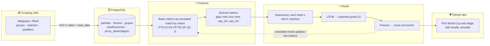
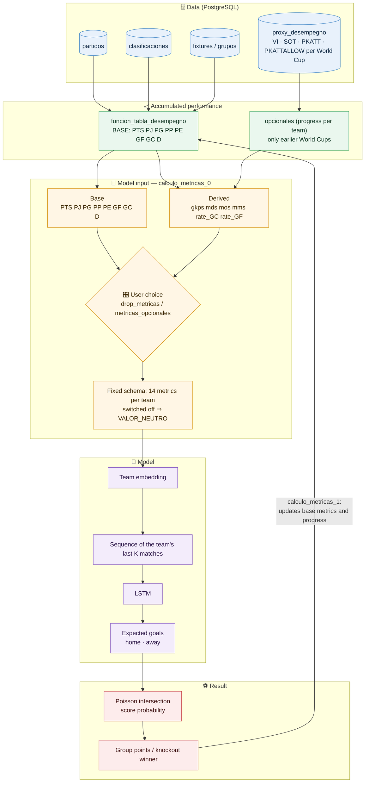
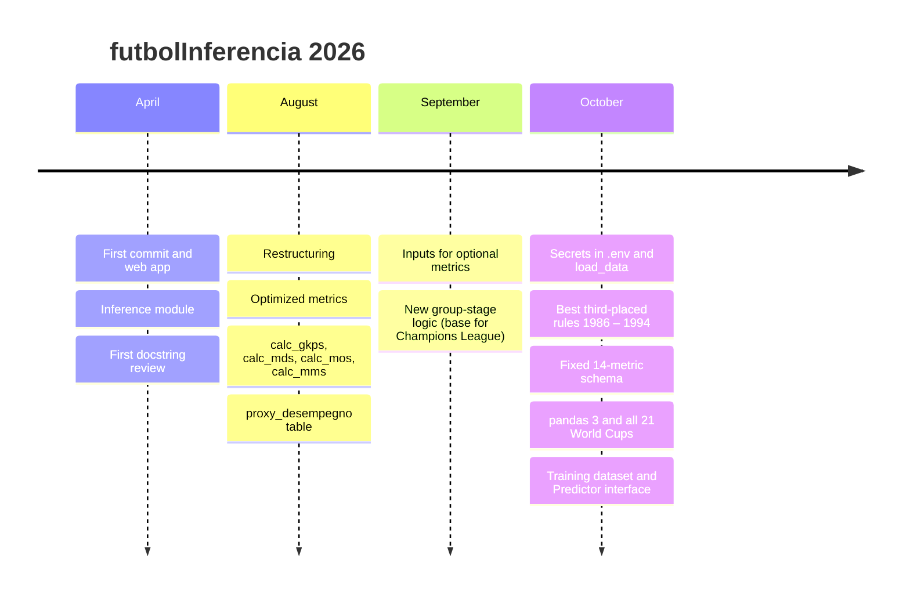

# futbolInferencia

**Simulate any FIFA World Cup (1934 – 2026) from any stage: change the results you want and a time-series model predicts the rest of the tournament, match by match.**

<!-- TODO (Phase 5): 15-second GIF of the "what if…?" mode, e.g.  -->


> **Status (October 2026):** the data pipeline, the tournament simulation (all 22 World Cups from 1934 to 2026) and the training dataset are working. The app uses the LSTM with Elo context, but the 25-October audit showed that it does **not** beat the pure Elo baseline. Stages A, B, C and F are now implemented and evaluated: Poisson GLM, Dixon-Coles, ordinal, LightGBM, Random Forest and an ensemble. The ensemble wins on rolling validation and on 2018+2022, but not on 2026; **no model is promoted** and the Elo remains the reference. Stage G (champion probabilities) and H (API/demo) are next. See [Model results](#model-results) and [Roadmap](#roadmap).

---

## What it does

- Lets the user pick a World Cup and a stage, edit any match result and simulate the rest of the tournament.
- Respects every historical format: straight knockout (1934/38), final group round (1950), second group stage (1974 – 82), best third-placed teams (1986 – 94), round of 16 (1998 – 2022).
- Each team carries its performance (points, wins, goals, defensive/offensive scores…) from the qualifiers into the tournament and updates it after every match, so the model sees the tournament as a **sequence**, not as isolated matches.
- Predicted goals are turned into results with a Poisson model.

**Stack:** Python 3.12 · Django 6 · PostgreSQL · TensorFlow/Keras · pandas · NumPy · SciPy · Selenium (scraping) · JavaScript (fetch).

---

## Architecture



### How the time-series model sees a tournament



**No data leakage:** every training row only contains information from *before* that match, and the shots/penalty history of a World Cup only adds up earlier World Cups.

**User control without changing the model input:** a discarded base metric or a rejected optional metric reaches the model with its `VALOR_NEUTRO`; no column is ever added or removed, so the model always receives the same shape.

**Framework-agnostic predictions:** the simulation only needs expected goals per match. Any model that implements `Predictor` (`web/fases/predictores.py`) can be plugged in: Keras, scikit-learn, a time-series foundation model… Each trained model is saved with an `esquema.json`, and the app refuses to load a model trained with different metrics.

---

## Project structure

```
futbolInferencia/
├── data/                       # versioned inputs (CSV + model); datasets/ is generated, not versioned
│   ├── partidos/  grupos/      # matches, fixtures, qualifiers and group tables
│   ├── proxy_desempegno/       # shots / clean sheets / penalties per World Cup (scraped)
│   └── modelos/                # trained models
├── etl/                        # scraping and data cleaning (busca_grupos.py --anio 1986, busca_metricas.py…)
├── notebooks/                  # training notebook (2024) and metric tuning
├── experimentos/               # prototypes and the 2026 re-download study (redescarga/)
├── web/                        # Django project
│   ├── mundial/                # settings (reads .env with python-decouple)
│   └── fases/
│       ├── models.py           # partidos, fixtures, grupos, clasificaciones, proxy_desempegno
│       ├── modulo.py           # metrics, tournament simulation, best-third-placed rules, inference
│       ├── dataset.py          # training dataset and per-team sequences
│       ├── predictores.py      # Predictor interface, baseline and model loading
│       ├── views.py            # page and /procesar_recepcion_1/ (predict)
│       ├── management/commands # load_data, construir_dataset
│       ├── templates/prediccion.html
│       └── tests.py
├── requirements.txt            # web app
└── requirements-dev.txt        # + notebooks, training and scraping
```

---

## Installation

Requirements: **Python 3.12**, **PostgreSQL 14+** and Git. Commands are shown for Windows PowerShell; on Linux/macOS use `source .venv/bin/activate` and `python3`.

**1. Clone and create the virtual environment**

```powershell
git clone https://github.com/Kozuki-4i-9/futbolInferencia.git
cd futbolInferencia
python -m venv .venv
.venv\Scripts\Activate.ps1
python -m pip install -r requirements.txt        # or requirements-dev.txt for notebooks and scraping
```

**2. Create the database** (in `psql` as the `postgres` user)

```sql
CREATE USER mundial WITH PASSWORD 'choose-a-password';
CREATE DATABASE bd_mundial OWNER mundial ENCODING 'UTF8' TEMPLATE template0;
```

**3. Configure the environment**

```powershell
copy web\.env.example web\.env
python -c "from django.core.management.utils import get_random_secret_key as k; print(k())"
```

Edit `web/.env`: paste the generated key in `SECRET_KEY` and the password from step 2 in `DB_PASSWORD`. The other values work as they are for a local install.

**4. Create the tables and load the data**

```powershell
cd web
python manage.py migrate
python manage.py load_data          # loads the CSV files in data/ (use --reemplazar to reload)
```

**5. Run**

```powershell
python manage.py runserver
```

Open http://127.0.0.1:8000.

**Tests**

```powershell
python manage.py test fases
```

**Optional commands**

| Command | What it does |
|---|---|
| `python manage.py construir_dataset` | Builds `data/datasets/partidos_features.csv` (≈ 8,800 matches, takes a few minutes) for training; `--ciclo internacionales` uses every national-team match between World Cups instead of only the qualifiers |
| `python manage.py evaluar_modelos` | Phase 2 in one command (~1 h on 4 CPU cores): picks the LSTM configuration, context and draw threshold with temporal validation, tests it on the 2018 + 2022 and 2026 World Cups against the three baselines, saves `experimentos/resultados_baseline.json` and the model in `data/modelos/lstm-<date>/`. `--solo-validacion` stops after the rolling validation, writes `experimentos/resultados_validacion.json` and never touches the hold-out |
| `python manage.py evaluar_b` | Rolling validation of the Stage B models (Poisson GLM, ordinal, Dixon-Coles with `xi = 0`, `0.05`, `0.1`) against the Elo; saves `experimentos/resultados_b.json`. It never touches the hold-out |
| `python manage.py evaluar_c` | Rolling validation of LightGBM (Poisson and multiclass) and Random Forest against the Elo; saves `experimentos/resultados_c.json` and `experimentos/importancia_c.json`. It never touches the hold-out |
| `python manage.py evaluar_f` | Fits the ensemble weights on an inner validation and evaluates the ensemble and the draw decisions on the rolling validation; saves `experimentos/resultados_f.json`. It never touches the hold-out |
| `python manage.py evaluar_final` | The **single** confirmatory look at 2018+2022 and 2026 for the Elo, GLM, LightGBM and the ensemble; saves `experimentos/resultados_finales.json`. Do not reuse it to choose another model |
| `python manage.py entrenar_b` | Trains and saves the three Stage B models up to `--hasta` (default 2022) in `data/modelos/<backend>/`, with `esquema.json` (and `coeficientes.json` for the GLM). It does not change `MODEL_DIR` |
| `python manage.py entrenar_c` | Trains and saves LightGBM Poisson, LightGBM multiclass and Random Forest up to `--hasta` (default 2022) in `data/modelos/<backend>/`. It does not change `MODEL_DIR` |
| `python manage.py snapshot_consulta` | Photo of `consulta_general` for 2018 and 1986 (116 matches): `--guardar` writes `experimentos/snapshot_consulta.json`, `--verificar` fails if the simulation changes; used as the safety net for the H.2 refactor |
| `python manage.py entrenar_predictor` | Retrains the baseline predictor from that file into `data/modelos/medias/` (`--hasta 2010` to leave later World Cups out) |
| `python etl/busca_internacionales.py` | Rebuilds `data/partidos/internacionales.csv` (≈ 50,000 national-team matches since 1872, with competition type and neutral venue) from martj42/international_results, translating team names to the Spanish ones used in the database |
| `python etl/construye_proxy.py` | Rebuilds `data/proxy_desempegno/` (clean sheets, shots on target and penalties per team and World Cup): clean sheets from the scores, shots and penalties from FBref where it has them (penalties since 1998, shots since 2018) and imputed elsewhere, flagged with `pk_real` / `sot_real` |
| `python etl/construye_mundial_2026.py` | Builds the 2026 World Cup rows (groups, fixture, matches with shoot-outs, missing 2024-2026 qualifiers) and the official 495-combination best-thirds table from Wikipedia; checks that the official table reproduces the 16 round-of-32 matches that were played |
| `python etl/busca_metricas.py --todos` | Downloads the FBref goalkeeping tables used by `construye_proxy.py` (needs Firefox; FBref blocks non-browser downloads) |
| `python etl/busca_grupos.py --anio 1986` | Downloads a World Cup's group tables from Wikipedia (`--todos` for all; needs Firefox and `requirements-dev.txt`) |

---

## Data collection: lessons from scraping Wikipedia

**How it started.** Group tables were scraped from Spanish Wikipedia with Selenium, **one script per World Cup** (`busca_grupos_1930.py` … `busca_grupos_2022.py`, still in the git history). Each page had its own quirks, so each script hard-coded them: the table's inline `style`, whether the group title was an `h3` or an `h4`, which tables to skip (`[1:]`, `[4:]`, `[:-1]`), the position of the title in a list, and machine-specific paths to `geckodriver.exe`.

**What broke.** Wikipedia later changed its HTML (titles moved from `<span id>` to `<h3 id>` inside `div.mw-heading`, modern tables changed style). Several scripts silently stopped finding anything — the 1986 one among them. Twenty copies of almost the same code also meant twenty places to fix.

**How it works now.** `etl/busca_grupos.py` uses **one rule for every year, based on content instead of layout**: a group table is a table whose header has a `Pts` column and that links to national teams; its name is the closest previous heading whose id starts with `Grupo_` (anything else, such as *Statistics* or the 1950 final round, is skipped). Validated against the 20 existing CSV files: all 20 identical. A full re-download (`experimentos/redescarga/`) also found that the old match scraper stored **penalty shoot-out scores as match scores** (35 knockout matches, e.g. the 2022 final as 4:2 instead of 3:3) and a 1938 match that was never played. Both are corrected in `data/partidos/partidos.csv` by `experimentos/redescarga/corregir_penales.py`: the score is now the one after 90 or 120 minutes, the shoot-out goes to its own `penales` column (used to decide who advances when a real draw is replayed) and the 1938 walkover is kept with `jugado = 0` so the training data skips it.

**Advice for the future**
- Select by **meaning** (column names, heading ids, link titles), never by inline styles or positions.
- **Validate every scraper against known data** (a previous download or a second source) before trusting it; scrapers fail silently.
- **Keep raw values apart from derived ones**: score, extra time and penalties in separate columns.
- **One parametrised script plus a small exceptions table** beats one script per case; let Selenium Manager find the browser driver instead of hard-coding paths.
- Keep the raw downloads (`data/redescarga/`) so a study can be repeated without hitting the site again, and respect the site: one request per page, no parallel crawling.

---

## Model results

**The 25-October audit changed the verdict: the pure Elo baseline is the model to beat, and the LSTM currently does not beat it.**

| Model | 2018 + 2022: correct outcome | log-loss | RPS | 2026: correct outcome | log-loss | RPS |
|---|---|---|---|---|---|---|
| (a) The team with more points per match in its cycle wins 1-0 | 46.1 % | 2.223 | 0.396 | 51.0 % | 2.025 | 0.360 |
| (b) Poisson with average goals | 43.0 % | 1.109 | 0.252 | 47.1 % | 1.067 | 0.234 |
| (c) Always 1-1 | 21.9 % | 3.206 | 0.378 | 23.1 % | 3.157 | 0.372 |
| **Elo puro (A.2, the strong baseline)** | **51.6 %** | **1.020** | **0.217** | **66.3 %** | **0.854** | **0.158** |
| LSTM used by the app (draw threshold 0.01) | 51.6 % | 1.013 | 0.216 | 63.5 % | 0.877 | 0.167 |
| LSTM without the draw threshold | 53.9 % | 1.013 | 0.216 | — | — | — |

Read it carefully:

- **Read the Elo row first.** In 2018+2022 the LSTM used by the app ties the Elo on accuracy (51.6 %) and improves log-loss by 0.0074, but the paired comparison is **not significant** (`p_dm = 0.817`, `p_mcnemar = 1.0`). In 2026 the Elo is better on all three metrics. The 53.9 % of the old README is the LSTM **without** the threshold, not the model the app uses.
- **Rolling validation (30-October):** Elo log-loss 0.8409 vs LSTM 0.8406; accuracy 62.4 % vs 61.6 %; ECE 0.011 vs 0.024. The difference is noise, not a credible advantage; see [`experimentos/resultados_validacion.json`](experimentos/resultados_validacion.json).
- **The draw threshold is not harmless.** Removing it takes accuracy from 51.6 % to 53.9 % in 2018+2022, and the model only predicts 3/28 draws there and 1/24 in 2026. Stage F.2 replaces it with a decision rule based on calibrated probabilities.
- **Exact score:** the Elo is also better in 2018+2022 (14.1 % vs 10.2 %) and in 2026 (11.5 % vs 8.7 %).
- **Elo is the context that helps most**: computed from ~50,000 national-team matches (eloratings.net rules), it lowers the validation Poisson deviance from 0.740 to 0.722. Tournament stage, playing in the host's confederation, rest days and the group situation did not improve validation beyond seed noise (see the json).
- 128 or 104 test matches give a ±9-point margin (95 % interval); a single test is therefore "probably better", not proof. The paired comparison and the rolling validation are what decide.
- Position scores (`gkps`, `mds`, `mos`, `mms`) are on a 0–100 scale dividing each historical stat by the matches of that same history (`VERSION_METRICAS = 2`); a model trained with other formulas is refused when loaded.

Temporal split, nothing from the future: the configuration is chosen training on every cycle up to 2010 and validating on the full 2014 cycle (868 matches). The test figures are the **25-October 2026** audit of [`experimentos/resultados_baseline.json`](experimentos/resultados_baseline.json); the test itself was not re-run in this stage because the hold-out is frozen. The rolling validation was re-run on 30-October with `python manage.py evaluar_modelos --solo-validacion` and is in [`experimentos/resultados_validacion.json`](experimentos/resultados_validacion.json), with intervals, ECE and paired comparisons per fold. Details in [`notebooks/evaluacion.ipynb`](notebooks/evaluacion.ipynb).

> **Hold-out status:** 2018+2022 and 2026 have already been looked at several times (three different 2026 figures are public). They are **historical, not virgin**. The one confirmatory look is reserved for Stage F.3; see [`docs/especificacion/registro-de-miradas.md`](docs/especificacion/registro-de-miradas.md).

### Stage B: classic models (30-October-2026)

The three classic models were evaluated on the same rolling validation (2006, 2010, 2014), with the same metrics as Stage A and **without touching 2018/2022/2026**. Reproduce with `python manage.py evaluar_b`; the JSON is [`experimentos/resultados_b.json`](experimentos/resultados_b.json). The full write-up, definitions and limitations are in [`docs/especificacion/03-resultados-b.md`](docs/especificacion/03-resultados-b.md).

| Model | log-loss | RPS | correct outcome | ECE |
|---|---:|---:|---:|---:|
| **Poisson GLM** (Elo, home, match type, rate_GF/rate_GC, gkps, mos) | **0.8366** | **0.1607** | **62.5 %** | 0.019 |
| **Elo puro** (reference) | 0.8409 | 0.1624 | 62.4 % | **0.015** |
| Dixon-Coles, `xi = 0.05` | 0.8520 | 0.1657 | 61.8 % | 0.023 |
| Dixon-Coles, `xi = 0.10` | 0.8534 | 0.1655 | 61.5 % | 0.021 |
| Ordinal logit | 0.8927 | 0.1693 | 61.3 % | 0.065 |

- **The Poisson GLM is the best of Stage B**, but the improvement over the Elo is **small and not yet statistically confirmed**: the paired log-loss difference is −0.0043 on average, with Diebold-Mariano `p` of 0.198, 0.747 and 0.073 in the three folds. The RPS improvement is also small (one fold reaches `p = 0.009`). It is a candidate, not a winner.
- **Dixon-Coles does not beat the Elo here.** Its `rho` is negative (around −0.05), which corrects low-score dependence, but with the current features and `xi` it does not improve log-loss. It is useful as an explainable benchmark and for its draw probabilities.
- **The ordinal model is the weakest**: its probabilities are poorly calibrated (ECE 0.065) even though its accuracy is close. It needs more informative features or a different link before it is useful.
- **Draws:** the real rate in the 2014 fold is 22.5 %. The mean predicted draw probability is around 20–22 %, but the *most likely* outcome is almost never a draw (0 % for Elo/GLM/ordinal, 1.6 % for Dixon-Coles). That is the problem Stage F.2 must solve; it is not solved by these models.

The fitted models are saved in `data/modelos/poisson_glm/`, `data/modelos/ordinal/` and `data/modelos/dixon_coles/` with their `esquema.json`; `Poisson GLM` also has `coeficientes.json`. They are **not** the app's model yet: `MODEL_DIR` still points to the LSTM until F.3 chooses the final candidate.

### Stage C: tree models (30-October-2026)

LightGBM (Poisson and multiclass) and Random Forest were evaluated on the same rolling validation, with `python manage.py evaluar_c`; JSON in [`experimentos/resultados_c.json`](experimentos/resultados_c.json).

| Model | log-loss | RPS | correct outcome | ECE |
|---|---:|---:|---:|---:|
| **Poisson GLM** | **0.8366** | **0.1607** | 62.5 % | 0.019 |
| LightGBM Poisson | 0.8382 | 0.1614 | **62.6 %** | 0.017 |
| Elo puro | 0.8409 | 0.1624 | 62.4 % | **0.015** |
| Random Forest | 0.8637 | 0.1670 | 60.4 % | 0.026 |
| LightGBM multiclass | 0.8946 | 0.1703 | 60.4 % | 0.055 |

LightGBM Poisson is a close second to the GLM and slightly better than the Elo, but the difference is not significant. The variable importance is clear: `elo_diff` dominates, followed by `rate_GC_rival`, `es_local`, `mos`, `gkps` and `rate_GF`. The multiclass and Random Forest result models are worse; their probabilities are poorly calibrated. Details in [`experimentos/importancia_c.json`](experimentos/importancia_c.json).

### Stage F: ensemble, draw decision and the single test look (30-October-2026)

The ensemble combines Elo + Poisson GLM + LightGBM Poisson with weights fitted on an **inner** validation (never on the outer validation or the test), then evaluated on 2006/2010/2014 with `python manage.py evaluar_f` ([`experimentos/resultados_f.json`](experimentos/resultados_f.json)).

| Model (rolling validation) | log-loss | RPS | correct outcome | ECE |
|---|---:|---:|---:|---:|
| **Ensemble** | **0.8327** | **0.1601** | **62.8 %** | 0.020 |
| Poisson GLM | 0.8366 | 0.1607 | 62.5 % | 0.019 |
| LightGBM Poisson | 0.8382 | 0.1614 | 62.6 % | 0.017 |
| Elo puro | 0.8409 | 0.1624 | 62.4 % | **0.015** |

The ensemble is the first candidate that beats the Elo with paired `p` values of 0.095, 0.047 and 0.028 (two of three folds below 0.05). It is a modest but more consistent gain than any single model.

**The one confirmatory test look** (F.3, `python manage.py evaluar_final`, JSON [`experimentos/resultados_finales.json`](experimentos/resultados_finales.json)):

| Model | 2018+2022 log-loss | outcome | 2026 log-loss | outcome |
|---|---:|---:|---:|---:|
| Elo puro | 1.0201 | 51.6 % | **0.8541** | **66.3 %** |
| Poisson GLM | 1.0117 | **53.1 %** | 0.8584 | 64.4 % |
| LightGBM Poisson | 1.0122 | 52.3 % | 0.8677 | 64.4 % |
| Ensemble | **1.0073** | 51.6 % | 0.8581 | 64.4 % |

The ensemble improves log-loss on 2018+2022 but is **not** better than the Elo on 2026, and on the test no difference is significant (`p_dm` 0.391 and 0.754). **No model is promoted**: `MODEL_DIR` remains `lstm-2026-10-25`. The honest conclusion is that the Elo is still the reference; the ensemble is a candidate for log-loss, not a proven winner.

**Draw decision (F.2):** the RPS rule predicts 26–30 % draws (the real rate is ~22 %), but it pays for it with 2–4 points of accuracy; the argmax rule predicts 0 % draws but has better accuracy. It is a trade-off, not a free improvement. The rule is implemented and tested (`decision_rps` in `evaluacion.py`), but not activated in the app. The detailed write-up is in [`docs/especificacion/04-resultados-c-f.md`](docs/especificacion/04-resultados-c-f.md).

### API, Docker and CI (H.1, H.3, H.6)

- **API:** `POST /api/prediccion/` accepts the same `recepcion` as the web and reuses `predecir_recepcion`; `GET /api/schema/` serves the OpenAPI schema and `GET /api/docs/` the Swagger UI. `POST /api/probabilidades/` is reserved for Stage G and currently returns **501**.
- **Docker:** `Dockerfile` (Python 3.12, `tensorflow-cpu`, gunicorn, WhiteNoise) and `docker-compose.yml` (PostgreSQL + web). Validate with `docker compose config`; to run: `docker compose up --build`.
- **CI:** `.github/workflows/ci.yml` runs Ruff (syntax/undefined names), `manage.py check`, and the 60 tests against PostgreSQL 16.
- **Not verified here:** the Docker daemon is not available in this environment, so the image was **not built**; `docker compose config` was validated. The GitHub Actions workflow has not run yet. Details in [`docs/especificacion/05-api-docker-ci.md`](docs/especificacion/05-api-docker-ci.md).

---

## Roadmap

- [x] Secrets out of the code, reproducible database (`load_data`), all 21 World Cups through 2022 simulated end to end (2026 included since October)
- [x] Training dataset without leakage and per-team sequences
- [x] Evaluation against baselines (`evaluar_modelos`, `notebooks/evaluacion.ipynb`)
- [x] Connect the app to `cargar_predictor` (baseline `PredictorMedias` in `data/modelos/medias/`)
- [x] Retrain the LSTM with the 14-metric schema and Elo context (`data/modelos/lstm-2026-10-25/`)
- [x] The app predicts with the LSTM (`MODEL_DIR=lstm-2026-10-25`; `MODEL_DIR=medias` goes back to the baseline)
- [x] Simulate from any stage of every World Cup, including the 1934 / 1938 replays and the 1950 final round
- [x] 2026 format (48 teams, 12 groups, 8 best third-placed teams) with the official 495-combination FIFA table (`FormatoTorneo`)
- [x] Stage A: close the probability benchmark (ECE, validation intervals, frozen hold-out, Elo as an artifact)
- [x] Stage B: Poisson GLM, Dixon-Coles and ordinal regression, evaluated against the Elo (Poisson GLM leads by a hair, not significant)
- [x] Stage C: LightGBM and random forest, with variable importance (LightGBM Poisson close second, multiclass/RF worse)
- [x] Stage F: ensemble, draw decision and the single final look (ensemble best on validation and 2018+2022, not on 2026; no model promoted)
- [ ] Stage G: Monte Carlo table of the five most likely champions
- [x] Stage H.1: API `POST /api/prediccion/` + Swagger (`/api/docs/`); `/api/probabilidades/` waits for G
- [x] Stage H.3: `Dockerfile` and `docker-compose.yml` (compose validated; image not built in this environment)
- [x] Stage H.6: GitHub Actions workflow with Ruff, `manage.py check` and tests (not run yet)
- [ ] Stage H.2/H.4/H.5/H.7: refactor, UI, Telegram bot and portfolio
- [x] Clean sheets per World Cup from the scores; shots and penalties imputed until the FBref data is downloaded (`proxy_desempegno`)
- [ ] Run `etl/busca_metricas.py --todos` to replace the imputed penalties (1998+) and shots on target (2018+) with real data
- [ ] Split `modulo.py` into smaller modules with tests
- [ ] Public demo and portfolio links

<details>
<summary>Project history</summary>



</details>

---

## Resumen en español

**futbolInferencia** simula cualquier Mundial (1934 – 2026) desde la fase que elijas: cambias los resultados que quieras y un modelo de series temporales (LSTM) predice el resto del torneo partido a partido. Cada selección arrastra su rendimiento desde las eliminatorias y lo actualiza tras cada partido; los goles predichos se convierten en resultados con un modelo de Poisson.

**Estado:** los datos, la simulación de los 22 Mundiales (incluido 2026) y el dataset de entrenamiento funcionan. La auditoría del 25 de octubre cambió el veredicto: el LSTM con Elo acierta el 51,6 % en 2018+2022 con el umbral de la app y el 63,5 % en 2026; el **Elo puro** obtiene 51,6 % y 66,3 %, así que el LSTM **no demuestra ser mejor**. Las etapas A, B, C y F están implementadas y evaluadas: GLM de Poisson, Dixon-Coles, ordinal, LightGBM, Random Forest y un ensamble. El ensamble gana en validación y en 2018+2022, pero no en 2026; **no se promueve ningún modelo** y el Elo sigue siendo la referencia. La web usa el LSTM (`MODEL_DIR=lstm-2026-10-25`) hasta que G/H y una nueva validación justifiquen otro modelo.

**Scraping:** empezó con un script de Selenium por Mundial, adaptado a cada página; cuando Wikipedia cambió su HTML varios dejaron de funcionar. Hoy un solo script (`etl/busca_grupos.py`) usa una regla basada en el contenido (columna «Pts» y título «Grupo…») y reproduce los 20 Mundiales. Detalles y lecciones en *Data collection* (arriba).

**Instalación rápida:** Python 3.12 y PostgreSQL → `pip install -r requirements.txt` → crear la base y el usuario (paso 2) → copiar `web/.env.example` a `web/.env` y completarlo → `python manage.py migrate` → `python manage.py load_data` → `python manage.py runserver`.
