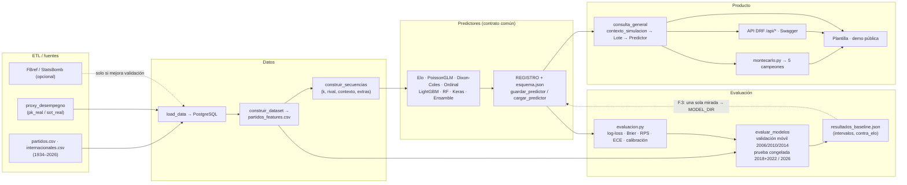

# futbolInferencia — Plan técnico accionable

**Documento:** 02 · Arquitectura, tareas y plan de ejecución
**Rol emisor:** Analista de Solución (Arquitecto de Software Senior)
**Entrada autoritativa:** `docs/especificacion/01-objetivos-y-restricciones.md` (Delimitador, 28-oct-2026)
**Destinatarios:** Programador Experto (ejecución) y QA (verificación)
**Fecha:** 28 de octubre de 2026
**Workspace:** `C:\Users\USUARIO\Trabajo\proyectos\mundiales\futbolInferencia`

> **Regla de lectura.** Este plan **no repite** la auditoría del Delimitador. Asume como hechos verificados: `check` limpio, 41 tests OK, GET / 200, BD 1.051/49.945/524, Elo puro como vara real (validación 0,8409 vs LSTM 0,8406; 2026 Elo 0,854 vs LSTM 0,877), `MODEL_DIR=lstm-2026-10-23` vs JSON `lstm-2026-10-25`, `VALOR_NEUTRO=None` rompe 3.6, `k=1` limitación real, `modulo.py` 3.056 líneas/21 `print`, y 1930 fuera de datos/código. Construye **sobre** ese diagnóstico.

---

## 0. Resumen ejecutivo

**El problema ya no es "hacer más grande el LSTM".** El Elo puro (Etapa A.2) desbancó al modelo actual: ninguna comparación pareada es significativa a favor del LSTM y, en 2026, el Elo tiene mejor punto estimado en las tres métricas. Por tanto, el plan ordena el trabajo así:

1. **Cerrar la verdad de la medición (Semana 1):** arreglar `VALOR_NEUTRO`, añadir ECE e intervalos/calibración en validación, persistir el Elo como vara oficial, blindar la no-fuga, congelar el hold-out y escribir el test de foto.
2. **Construir candidatos que puedan ganarle al Elo (Semanas 2–4):** modelos clásicos (Poisson GLM, Dixon-Coles, ordinal) y árboles (LightGBM, Random Forest). La red a fondo (D) y los datos externos (E.2/E.3) quedan como "si hay tiempo".
3. **Elegir con evidencia y publicar (Semanas 5–6):** ensamble, regla de empates, **una sola mirada final** en 2018+2022 y 2026, modelo final en la app, cuadro de 5 campeones (Montecarlo).
4. **Producto (Semanas 6–8):** refactor con snapshot, API DRF, Docker/despliegue, UI, CI y portafolio.

**Corte por defecto (SUPUESTO, pendiente D-14):** el **recomendado** — A + B + C + F + G + H.1/H.2 (+ H.3/H.6 mínimos y H.7 opcional) ≈ **8 semanas** para una sola persona. D, E.2 y E.3 son recortables sin romper la narrativa "mejor que Elo".

---

## 1. Arquitectura de la solución

### 1.1 Piezas existentes y cómo encajan

| Pieza | Responsabilidad actual | Cómo se usa |
|---|---|---|
| `web/fases/predictores.py` | Interfaz `Predictor` (Protocolo), `Lote` (entrada), backends `Medias`/`MasPuntos`/`Empate`/`Keras`/`Elo`, `REGISTRO`, `guardar_predictor`, `cargar_predictor` | Único punto de entrada/salida de modelos; **nadie carga un modelo por fuera de `cargar_predictor`**. |
| `web/fases/evaluacion.py` | `log_loss`/`brier`/`rps`, calibración (10 tramos), `intervalos_bootstrap`, `comparar` (bootstrap pareado + Diebold-Mariano + McNemar), `particion`, `evaluar` | Vara de medir. **Falta `ece()` y que la validación móvil guarde intervalos/calibración.** |
| `web/fases/dataset.py` | `construir_dataset` (una fila por partido, sin fuga), `construir_secuencias`, `EXTRAS`/`EXTRAS_EN_APP`, `agregar_contexto` | Genera la tabla de entrenamiento y las secuencias. Es la fuente de verdad de las columnas de entrada. |
| `web/fases/contexto.py` | Elo, confederaciones, descanso, `contexto_de_mundiales`, `contexto_desde_bd` (cacheado) | Elo y contexto **idénticos** en entrenamiento y en la app. |
| `web/fases/modulo.py` | `ALL_METRICS` (14), `VERSION_METRICAS`, `VALOR_NEUTRO`, `calculo_metricas_0/1`, `neutralizar`, `validar_valores_neutros`, `consulta_general`, `obtener_dic_agnos`, `FormatoTorneo`, simulación | Motor de la app y de las métricas. 3.056 líneas; `VALOR_NEUTRO=None`; 21 `print`. |
| `web/fases/views.py` | `procesar_recepcion_0` (GET /) y `procesar_recepcion_1` (POST predicción) | Puerta de entrada web. Añadirá la ruta `/probabilidades/`. |
| `management/commands/evaluar_modelos.py` | Validación móvil 2006/2010/2014 + prueba 2018+2022/2026 + JSON | Se amplía para guardar intervalos/calibración en validación y un modo `--solo-validacion`. |
| `management/commands/construir_dataset.py`, `entrenar_predictor.py`, `load_data.py` | Generar dataset, entrenar baseline de medias, cargar BD | Sin cambios de contrato. |
| `esquema.json` (por carpeta en `data/modelos/`) | `backend`, `config`/`coef`/`media_*`, `metricas` (14), `version_metricas`, y `extra` (fecha, `entrenado_hasta`, `prueba`) | Contrato persistido; `cargar_predictor` lo verifica. |

**Pieza clave (verificada en código):** la app construye la entrada a cualquier predictor con `lote_desde_entrada(X)` + `contexto_simulacion(tabla)` (`modulo.py:1583-1607`). El `Lote.tabla` que recibe el modelo contiene:

```
home_id, away_id,
ALL_METRICS_0 (14), ALL_METRICS_1 (14),
home, away, categoria, neutral, local_0, local_1,
pk_real_0/1, sot_real_0/1,
elo_0/1, local_continental_0/1, fase_final
```

Esas **mismas columnas** existen en el dataset de entrenamiento (vía `construir_dataset` + `agregar_contexto`). Por eso un modelo nuevo solo debe leer columnas presentes en ambos lados. Las columnas de `EXTRAS` que **no** están en `EXTRAS_EN_APP` (`descanso`, `grupo`) existen en el dataset pero **no** en la app: un modelo que las use debe declararlo y **no podrá desplegarse** salvo que se adapte `contexto_simulacion` (decisión D-04, misma regla que ya aplica `PredictorKeras.secuencias_desde_tabla`).

### 1.2 Módulos/archivos nuevos

El repo usa una estructura plana (`web/fases/*.py`) y ya concentra el contrato en `predictores.py`. Para **no duplicar lógica ni romper el contrato**, se añaden módulos de backends que se registran en `REGISTRO`, dejando la interfaz donde está:

| Archivo nuevo | Responsabilidad | Justificación |
|---|---|---|
| `web/fases/modelos_estadisticos.py` | `PredictorPoissonGLM`, `PredictorDixonColes`, `PredictorOrdinal` (Etapa B) | Separa los modelos de `statsmodels`/`scipy` del contrato; `predictores.py` no crece a ~1.500 líneas. |
| `web/fases/modelos_arboles.py` | `PredictorLightGBM`, `PredictorRandomForest` (Etapa C) | Igual motivo; importa `lightgbm`/`sklearn` solo aquí (import perezoso para no encarecer el arranque). |
| `web/fases/ensamble.py` | `PredictorEnsamble` (Etapa F) | Combina predictores registrados por pesos; lógica aislada y testeable. |
| `web/fases/montecarlo.py` | `simular_torneo(lambdas_por_pareja, formato, n=5000)` en numpy (Etapa G) | Sin dependencia de `consulta_general` ni de HTTP (R-19). |
| `web/fases/api/` (paquete: `serializers.py`, `views.py`, `urls.py`) | Endpoints DRF `/api/prediccion/` y `/api/probabilidades/` + Swagger (H.1) | DRF/spectacular aislados de las vistas HTML; reutiliza `consulta_general` y `montecarlo`. |
| `web/prediccion/` (paquete, refactor H.2) | `datos.py`, `metricas.py`, `formatos.py`, `modelo.py`, `simulacion.py` | Parte `modulo.py` según v1 §4.2; **solo después del test de foto**. |

**Regla de registro sin importes circulares:** `predictores.py` define `Lote`, los backends base y `REGISTRO`; al **final** del archivo importa los módulos nuevos y hace `REGISTRO.update(...)` (o consume un `PREDICTORES = {nombre: desde_esquema}` que cada módulo expone). Los módulos nuevos importan `Lote` de `.predictores` (ya definido en ese punto), evitando el ciclo.

### 1.3 Contrato de cada modelo nuevo

Todo modelo nuevo cumple **exactamente** el contrato existente (`predictores.py:61-404`) y, además, una regla de columnas:

1. `nombre: str` (clase), registrado en `REGISTRO`.
2. `predecir(self, lote: Lote) -> np.ndarray (n, 2)` — goles esperados home/away.
3. `probabilidades(self, lote) -> np.ndarray (n, 3)` — **opcional**, solo si el modelo tiene distribución de resultado propia (ordinal, Dixon-Coles, LightGBM-multiclase, ensamble). Si no existe, `evaluacion` y la app derivan el resultado de las dos Poisson (no lo implementes "para cumplir"; implementarlo mal cambia empates y resultados sin beneficio).
4. `entrenar(cls, dataset, ...) -> instancia` (classmethod, espejo de `PredictorElo.entrenar`/`PredictorMedias.entrenar`).
5. `a_esquema(self) -> dict` con `"backend": self.nombre` + estado serializable (coeficientes/`config`/pesos).
6. `desde_esquema(cls, esquema, carpeta) -> instancia`.
7. `guardar_pesos(self, carpeta)` — opcional, solo si hay artefacto binario (LightGBM `.txt`, pickle, etc.).
8. **Columnas requeridas declaradas:** el modelo lista en `a_esquema` las columnas que consume más allá de `ALL_METRICS` (p. ej. `elo`, `local`, `neutral`, `categoria`); `predecir`/`probabilidades` lanzan `ValueError` claro si el `Lote` no las trae (patrón ya usado en `PredictorKeras.secuencias_desde_tabla`). Ningún modelo nuevo usa `descanso`/`grupo` sin decisión D-04/D-08.
9. Guardado **siempre** con `guardar_predictor(predictor, carpeta, fecha=..., entrenado_hasta=..., prueba=...)`, que ya inyecta `metricas` (14) y `version_metricas` (2). Carga **siempre** con `cargar_predictor`.

**Esquema fijo de 14 métricas (R-04/R-05):** `ALL_METRICS` es la única fuente de verdad del orden. Ninguna tarea añade/elimina una columna de la entrada. Cambiar una fórmula ⇒ `VERSION_METRICAS += 1` + reentrenar todo + `cargar_predictor` rechaza versiones viejas (ya implementado y testeado). xG/StatsBomb entra como columna de **contexto/`extra`** (como `elo`), nunca como 15.ª métrica (decisión D-08).

**No-duplicación:** los modelos comparten (a) `probabilidades_resultado`/`resultado_y_marcador` de `evaluacion.py` para convertir λ en resultado, (b) `PredictorElo.diferencia` como utilidad reutilizable de la variable Elo, (c) `evaluar`/`comparar` de `evaluacion.py` para medir, y (d) `construir_dataset`/`agregar_contexto` para las columnas de contexto. No se reimplementa Elo, Poisson-intersección, bootstrap ni partición en ningún backend nuevo.

### 1.4 Diagrama de flujo (datos → entrenamiento → evaluación → despliegue)



---

## 2. Decisiones y supuestos

### 2.1 Supuestos de trabajo sobre D-01…D-20

Las decisiones 🔴 son **del dueño, no del Analista ni del Programador**. Aquí se adoptan supuestos explícitos para poder planificar; cada tarea que dependa de una decisión queda **marcada como bloqueada** hasta confirmación. Ninguna se resuelve "en silencio": si el dueño decide distinto, se reescribe solo la tarea afectada.

| ID | Decisión | Supuesto adoptado en este plan | Efecto / bloqueo |
|---|---|---|---|
| **D-01** | ¿Elo como modelo final si nada lo supera? | **SUPUESTO:** sí. El objetivo es "superar al Elo en log-loss y RPS con evidencia pareada"; si ningún candidato lo logra, se despliega Elo puro y se documenta honestamente. No se fuerza el LSTM. | Desbloquea A-04/F-03. Si el dueño exige "red sí o sí", F.3 cambia. |
| **D-02** | ¿Congelar 2018+2022 y 2026 hasta F.3? | **SUPUESTO:** sí. Se congela hasta F.3; toda mirada se registra; las cifras actuales (63,8/63,46/66,35) se declaran "históricas, no vírgenes". | Desbloquea A-00/F-03. |
| **D-03** | Alcance exacto de H.2 | **SUPUESTO:** H.2 = 4.1 (snapshot) + 4.2 (partir) + 4.4 (logging/ruff) + 4.5 (tests de negocio). 4.3 (CharField→IntegerField) se **pospone** (opcional). | Desbloquea H-01. 4.3 queda como tarea opcional H-01e. |
| **D-04** | ¿`k>1` en la app? | **SUPUESTO:** mantener `k=1` para la app en este plan. D.4 (secuencias largas) es **opcional** y se documenta la limitación; no se finge que se probó si no se adapta `contexto_simulacion`. | D-04 (tarea) bloqueada si se quiere desplegar `k>1`. |
| **D-05** | ¿Reemplazar el umbral 0,01? | **SUPUESTO:** sí, en F.2, por la regla que maximiza acierto esperado / minimiza RPS con probabilidades calibradas. | Desbloquea F-02. |
| **D-06** | Umbral de calibración | **SUPUESTO:** ECE ≤ 0,03; tramos con `n ≥ 20` y desviación ≤ 0,07. | Desbloquea A-02. |
| **D-07** | `VALOR_NEUTRO` | **SUPUESTO:** rellenar con las medias del entrenamiento (sin fuga), manteniendo la UI. | Desbloquea A-01. Si el dueño prefiere ocultar controles, A-01 se reduce a deshabilitar la UI + test. |
| **D-08** | xG/StatsBomb vs 14 métricas | **SUPUESTO:** xG entra como columna de **contexto/`extra`** (como `elo`), **no** como 15.ª métrica; sin `VERSION_METRICAS=3`. | Desbloquea E-02 (acotada). |
| **D-09** | ¿1930 dentro o fuera? | **SUPUESTO:** corregir README a **1934–2026** (bajo riesgo). Añadir 1930 es opcional y bloqueado. | Desbloquea A-08. |
| **D-10** | ¿Promover `lstm-2026-10-25` o reentrenar? | **SUPUESTO:** promover **ahora** `lstm-2026-10-25` (es el modelo evaluado); en F.3 se re-promueve el ganador. | Desbloquea A-08 (MODEL_DIR). |
| **D-11** | Licencias de datos externos | **SUPUESTO:** producir la tabla fuente × dato × años × licencia **antes** de E.2/E.3; solo entra lo de licencia clara. | Desbloquea E-00. |
| **D-12** | ¿Se ejecuta E.1 antes de F? | **SUPUESTO:** intentar E.1; si FBref bloquea, documentarlo y mantener proxy imputado (sin afirmar "real vs imputado"). | Desbloquea E-01. |
| **D-13** | Métrica primaria, alpha, tamaño de efecto | **SUPUESTO:** log-loss primaria, RPS secundaria, α=0,05, IC 95 % sin 0; se reporta `p_dm`/`p_mcnemar`; se anota la advertencia de multiplicidad (128/104 partidos). | Desbloquea la vara. |
| **D-14** | Corte de alcance | **SUPUESTO:** corte **recomendado** (ver 2.2). | Desbloquea la hoja de ruta. |
| **D-15** | Reproducibilidad TF | **Técnico (no dueño):** reportar media ± desviación de 3 semillas; no exigir bit-exactitud. | — |
| **D-16** | Refactor sin snapshot | **Técnico, bloqueante:** test de foto 2018/1986 antes de tocar `modulo.py`. | Obliga A-06 antes de H-01. |
| **D-17** | Versionar la spec | **SUPUESTO:** añadir la spec a `docs/` en una rama de documentación aparte (no en este PR). | Tarea opcional al final. |
| **D-18** | Despliegue y memoria TF | **SUPUESTO:** el modelo final puede ser B/C (sin TF); Docker usa `tensorflow-cpu`; si no cabe, se usa el ganador B/C. | Desbloquea H-03. |
| **D-19** | Falta test de integración | **Técnico:** añadir smoke GET/POST + test de carga del modelo. | Desbloquea A-01/A-07. |
| **D-20** | "Una sola mirada" | **SUPUESTO:** "mirada" = evaluación confirmatoria en F.3; A–E usan solo validación; las miradas extraordinarias se registran. | Desbloquea A-00. |

### 2.2 Secuencia y corte de alcance (una persona)

La v2 asume paralelismo (B/C/D/E a la vez); el repo no muestra un equipo grande. **Propuesta para una persona:**

| Corte | Contenido | Semanas | Nota |
|---|---|---|---|
| **Mínimo vendible** | A + B + F + H.1/H.2 (+ H.7 opcional) | 5–6 | Cubre O-01…O-05, O-10…O-12, O-14/O-15. Sin árboles ni G. |
| **Recomendado (por defecto)** | A + B + C + F + G + H.1/H.2/H.3/H.6 (+ H.7 opcional) | **≈ 8** | Añade árboles (O-06), Montecarlo (O-13) y demo. |
| **Completo** | A–H | 10–12 | Añade D, E.2/E.3, H.4/H.5 completos. |

**Orden de una persona (no paralelo de verdad):** A (medición) → B (clásicos) → C (árboles) → F (ensamble/elección) → G (Montecarlo) → H (producto). Lo único **realmente paralelizable** en solitario es lo **asíncrono/no bloqueante**: (a) el test de foto (A-06) y la tabla de licencias (E-00) se escriben mientras corre un entrenamiento/evaluación; (b) E.1 (scraping FBref) puede lanzarse como trabajo de fondo. B y C **no** se hacen en paralelo real: compiten por la misma cabeza y por el mismo `evaluar_modelos`.

---

## 3. Desglose de tareas

> Convenciones: **Esfuerzo** en días-persona (d). **🔒** = bloqueada por decisión del dueño. **⚙ opcional** = recortable; se indica qué se pierde si se omite. Cada tarea es un PR pequeño y revisable. Las dependencias se listan como IDs.

### Bloque A — Cerrar la vara de medir (Semana 1)

#### A-00 · Congelar la prueba, registrar miradas y `--solo-validacion`
- **Objetivo:** blindar el hold-out y añadir el modo "solo validación" a `evaluar_modelos`.
- **Por qué:** hay 3 cifras públicas de 2026; sin congelado, cualquier mejora futura es ruido. Desbloquea R-01/R-02 y todas las comparaciones.
- **Archivos:** `web/fases/management/commands/evaluar_modelos.py`, `docs/especificacion/registro-de-miradas.md` (nuevo), `README.md` (mención corta).
- **Pasos:** (1) crear `registro-de-miradas.md` con fecha, qué se miró, por qué, quién; marcar 63,8/63,46/66,35 como históricas. (2) Añadir flag `--solo-validacion` que ejecute solo pliegues 2006/2010/2014 y guarde un JSON parcial (`resultados_validacion.json`) **sin tocar** `resultados_baseline.json` ni la prueba. (3) Documentar la regla en el docstring.
- **Aceptación:** `python manage.py evaluar_modelos --solo-validacion` corre sin evaluar 2018+2022/2026 y no escribe `prueba`; `registro-de-miradas.md` existe; `git diff` muestra solo lo previsto.
- **Dependencias:** — (va primero). **Esfuerzo:** 0,5 d. **Riesgo/rollback:** bajo; revertir es borrar el flag y el doc.

#### A-01 · Rellenar `VALOR_NEUTRO` y probar la neutralización
- **Objetivo:** que descartar una métrica devuelva 200 (neutralización), no 400.
- **Por qué:** 3.6 está roto (`VALOR_NEUTRO = {m: None}` ⇒ `drop_metricas` → 400). Urgente y visible. Cumple R-06/H-05.
- **Archivos:** `web/fases/modulo.py` (constante), `web/fases/tests.py`, `web/fases/views.py` (solo si se confirma el mensaje).
- **Pasos:** (1) calcular las medias de cada métrica en el dataset de entrenamiento **sin fuga**: media de `ALL_METRICS_0` y `ALL_METRICS_1` sobre `data/datasets/partidos_features.csv` (o del subconjunto `agno <= 2022`); (2) escribir `VALOR_NEUTRO = {m: media}` en orden `ALL_METRICS`; (3) test: `validar_valores_neutros` no lanza; `neutralizar` reemplaza solo las apagadas y conserva forma; (4) smoke POST a `/procesar_recepcion_1/` con `drop_metricas=["GF"]` ⇒ 200 y la predicción mantiene dimensiones.
- **Aceptación:** `python manage.py test fases` verde (nuevos tests incluidos); POST con `drop_metricas` devuelve 200; ningún `VALOR_NEUTRO` es `None`.
- **Dependencias:** — (solo requiere el dataset existente). **Esfuerzo:** 0,5–1 d. **Riesgo/rollback:** nulo en código de simulación; si las medias cambian predicciones, es esperado y se documenta.

#### A-02 · `ece()` y test a mano en `evaluacion.py`
- **Objetivo:** cuantificar calibración con ECE (además de la tabla de 10 tramos).
- **Por qué:** G-04/D-06 exigen un umbral; la tabla sola no da un número. Desbloquea la comparación "calibrado o no".
- **Archivos:** `web/fases/evaluacion.py`, `web/fases/tests.py`.
- **Pasos:** (1) `def ece(real, probs, tramos=10) -> float` (media ponderada de |probabilidad media − frecuencia| por tramo); (2) test a mano con 2 partidos y valores conocidos (caso calculado a lápiz); (3) test de tramos vacíos (no aportan).
- **Aceptación:** `python manage.py test fases` verde; `ece` da el valor a mano esperado en el test.
- **Dependencias:** — . **Esfuerzo:** 0,5 d. **Riesgo/rollback:** nulo.

#### A-03 · Intervalos y calibración en la validación móvil
- **Objetivo:** que `evaluar_modelos` guarde, por pliegue de validación, los intervalos bootstrap y la tabla de calibración (hoy solo en prueba).
- **Por qué:** es el hueco exacto de O-01/G-06: "validación sin intervalos ni calibración guardada". Sin esto, A no cierra.
- **Archivos:** `web/fases/management/commands/evaluar_modelos.py` (cambiar `evaluar` por `evaluar(..., por_partido=True)` en validación y persistir), `web/fases/evaluacion.py` (si hay que exponer un helper).
- **Pasos:** (1) en `validacion_lineas_base` y en la selección LSTM, guardar por pliegue `intervalos_bootstrap` + `calibracion` + `ece`; (2) reflejar en el JSON (`validacion_lineas_base[*].pliegues[*]`); (3) mantener la prueba intacta (ya guarda intervalos/calibración).
- **Aceptación:** `resultados_baseline.json` (tras re-run en A-07) incluye `intervalos`/`calibracion`/`ece` en cada pliegue de validación; test unitario que verifica el guardado con datos sintéticos.
- **Dependencias:** A-02. **Esfuerzo:** 1–1,5 d. **Riesgo/rollback:** medio (toca el comando de evaluación); mitigación: el flag `--solo-validacion` (A-00) permite iterar barato.

#### A-04 · Persistir `PredictorElo` como vara oficial + comparación completa vs Elo
- **Objetivo:** tener el Elo entrenado hasta 2022 guardado en `data/modelos/elo/` y que toda tabla incluya la diferencia vs Elo con IC y p.
- **Por qué:** O-02/R-17. El Elo ya es la vara; falta que sea un artefacto de primera clase (y candidato a `MODEL_DIR`).
- **Archivos:** `web/fases/management/commands/evaluar_modelos.py`, (opcional) comando `entrenar_predictor.py` extendido o un paso en `evaluar_modelos`.
- **Pasos:** (1) guardar `PredictorElo.entrenar(ds[tr_2026])` en `data/modelos/elo/` con `guardar_predictor(..., fecha=..., entrenado_hasta=2022)`; (2) verificar que `contra_elo` se calcula para **todos** los modelos (baselines, LSTM y futuros) en log-loss y RPS con intervalo + `p_dm` + `p_mcnemar`; (3) incluir la fila Elo en todas las tablas.
- **Aceptación:** existe `data/modelos/elo/esquema.json` con `backend="elo"` y carga con `cargar_predictor`; test de guardar/cargar del Elo (ya existe parcial en `tests.py`).
- **Dependencias:** A-00. **Esfuerzo:** 0,5 d. **Riesgo/rollback:** nulo.

#### A-05 · Auditoría y tests de no-fuga (leakage)
- **Objetivo:** demostrar con tests que ninguna fila ve su resultado ni el futuro (dataset, Elo, proxy, simulación).
- **Por qué:** O-04/R-03/G-09; es la restricción más cara de reparar y hoy solo hay tests parciales de dataset.
- **Archivos:** `web/fases/tests.py` (mayoritariamente), y un doc corto `docs/especificacion/auditoria-fuga.md`.
- **Pasos:** (1) test: en `construir_dataset`, la métrica de la fila N no incluye el marcador de N (ya hay test parcial; ampliar); (2) test: `particion` con `hasta` excluye el futuro; (3) test: `calcular_elo` usa el Elo **anterior** al partido (no el posterior); (4) test: `historico_abstractas` solo suma mundiales anteriores (ya existe, reforzar); (5) revisar `agregar_contexto` y `construir_dataset` y escribir el doc con hallazgos (0 esperados o corrección si aparece).
- **Aceptación:** tests de fuga verdes; `auditoria-fuga.md` lista cada mecanismo y su test; 0 hallazgos sin test.
- **Dependencias:** — . **Esfuerzo:** 1 d. **Riesgo/rollback:** si aparece fuga real, se abre tarea de corrección (no se tapa).

#### A-06 · Test de foto `consulta_general` 2018 y 1986 (precondición H.2)
- **Objetivo:** snapshot JSON de `consulta_general` para 2018 y 1986, que debe pasar antes y después del refactor.
- **Por qué:** D-16/R-12. Sin snapshot, dividir `modulo.py` es riesgo puro. Es **bloqueante para H.2** y puede hacerse ya.
- **Archivos:** `web/fases/tests.py` (nuevo), `web/fases/fixtures/snapshot_*.json` (o inline).
- **Pasos:** (1) con la BD de prueba, ejecutar `consulta_general("grupo2018", ...)` y `consulta_general("grupo1986", ...)`; (2) guardar marcadores/resultados esperados en JSON; (3) test que los compara exactamente.
- **Aceptación:** test verde; el snapshot se regenera solo con un flag explícito (no se reescribe a mano).
- **Dependencias:** — (usa la BD ya cargada). **Esfuerzo:** 1 d. **Riesgo/rollback:** nulo; es red de seguridad.
- **Nota:** si la BD de prueba no está disponible para `SimpleTestCase`, usar `TransactionTestCase` o un fixture mínimo; decidir en la tarea y documentarlo.

#### A-07 · Gate de cierre Etapa A (re-ejecutar y verificar)
- **Objetivo:** regenerar `resultados_baseline.json` con intervalos/calibración en validación y verificar la app.
- **Por qué:** cierra O-01 con evidencia reproducible (G-06). La ejecución completa ≈ 1 h (se lanza como trabajo de fondo).
- **Archivos:** ninguno (solo ejecutar y revisar).
- **Pasos:** (1) `python manage.py construir_dataset` (si el dataset no está al día); (2) `python manage.py evaluar_modelos` (fondo); (3) `python manage.py check`, `python manage.py test fases`, GET / 200, POST smoke.
- **Aceptación:** JSON con `validacion_lineas_base` incluyendo intervalos/calibración/`ece`; 41+ tests verdes; app arranca.
- **Dependencias:** A-00, A-01, A-02, A-03, A-04. **Esfuerzo:** 0,5 d + 1 h de ejecución. **Riesgo/rollback:** solo re-ejecución; no toca código.

#### A-08 · Publicar Etapa A: README/notebook/JSON/`MODEL_DIR` coherentes
- **Objetivo:** que los cuatro artefactos cuenten la misma historia (R-20) y que la app use el modelo evaluado.
- **Por qué:** H-02…H-07. Hoy el README dice "mejor baseline 46,1 %" (ignora Elo), publica 53,9/63,8 sin log-loss y `MODEL_DIR` apunta a 10-23.
- **Archivos:** `README.md` (secciones Model results/Status/Resumen), `notebooks/evaluacion.ipynb`, `web/.env.example`, `web/mundial/settings.py` (default), opcional `data/modelos/`.
- **Pasos:** (1) sustituir la tabla por la del JSON 25-oct **incluyendo la fila Elo puro** con log-loss/RPS/Brier/acierto/intervalos; (2) corregir la frase de resultados (log-loss y margen vs Elo, no "53,9 %"); (3) corregir 1930→1934–2026 (D-09); (4) `MODEL_DIR=lstm-2026-10-25` en `.env.example` y default de `settings.py` (🔒 D-10); (5) regenerar la celda de resultados del notebook.
- **Aceptación:** 0 contradicciones entre README/notebook/JSON/`esquema.json` (revisión manual + script de comparación de cifras si se automatiza); `cargar_predictor(MODEL_PATH/MODEL_DIR)` carga.
- **Dependencias:** A-07 (números), 🔒 D-09/D-10 para 1930/`MODEL_DIR`. **Esfuerzo:** 1 d. **Riesgo/rollback:** bajo; revertir es un commit.

---

### Bloque B — Modelos estadísticos clásicos (Semanas 2–3)

#### B-00 · Añadir `statsmodels` a dependencias
- **Objetivo:** poder importar GLM/OrderedModel.
- **Por qué:** B.1/B.3 lo requieren; R-15 (versión fijada, justificar).
- **Archivos:** `requirements.txt` (o `requirements-dev.txt` si el modelo final no lo necesita en runtime; ver nota).
- **Pasos:** añadir `statsmodels==<versión>` con versión fijada y nota de compatibilidad Python 3.12; probar `pip install -r requirements.txt` en entorno limpio.
- **Aceptación:** import de `statsmodels` OK; `pip install` sin conflictos con TF 2.21/numpy 2.5.
- **Dependencias:** — . **Esfuerzo:** 0,25 d. **Riesgo/rollback:** bajo (pin de versión).
- **Nota:** si un modelo B/C gana y se despliega, su dependencia va en `requirements.txt`; hasta entonces puede vivir en dev. Decidir en F.3.

#### B-01 · `PredictorPoissonGLM`
- **Objetivo:** GLM de Poisson (una fila por equipo y partido) con `statsmodels`.
- **Por qué:** rápido, explicable, candidato a ganar al Elo y a arreglar empates (O-05). Contrato R-07.
- **Archivos:** `web/fases/modelos_estadisticos.py` (nuevo), `web/fases/predictores.py` (registrar), `web/fases/tests.py`.
- **Pasos:** (1) clase con `nombre="poisson_glm"`, `entrenar`, `predecir` (exp de la combinación lineal), `a_esquema` (coeficientes + columnas usadas), `desde_esquema`; (2) variables: diferencia de Elo, local/neutral, tipo de partido, `rate_GF` propio, `rate_GC` del rival, `gkps`, `mos`; (3) registrar en `REGISTRO`; (4) test de contrato (guardar/cargar roundtrip, shape `(n,2)`, coeficientes en esquema); (5) test a mano de `predecir` con coeficientes fijos.
- **Aceptación:** `cargar_predictor` reconstruye el GLM; test roundtrip verde; `evaluar` devuelve métricas finitas.
- **Dependencias:** B-00. **Esfuerzo:** 1–1,5 d. **Riesgo/rollback:** bajo; aislamiento en módulo nuevo.

#### B-02 · `PredictorOrdinal` (probabilidades propias + marcador con GLM)
- **Objetivo:** regresión logística ordinal del resultado (pierde/empata/gana).
- **Por qué:** O-05; da `probabilidades(n,3)` nativa y permite comparar empates predichos. Combina su resultado con los goles esperados del GLM para el marcador.
- **Archivos:** `web/fases/modelos_estadisticos.py`, `web/fases/predictores.py`, `web/fases/tests.py`.
- **Pasos:** (1) `nombre="ordinal"`; `entrenar` ajusta `OrderedModel` con diferencia de Elo, contexto y diferencias de `rate_GF`/`rate_GC`/`mms`; (2) implementar `probabilidades` (n,3) y `predecir` (goles esperados delegando a `PredictorPoissonGLM` para el marcador); (3) registrar; (4) tests: `probabilidades` suma 1; empates predichos > 0 en un lote con partidos parejos; roundtrip.
- **Aceptación:** en la evaluación, la tasa de empates predichos se acerca a la real (~22 %) más que el LSTM actual; tests verdes.
- **Dependencias:** B-00, B-01. **Esfuerzo:** 1–1,5 d. **Riesgo/rollback:** bajo.

#### B-03a · `PredictorDixonColes` — ajuste base
- **Objetivo:** Poisson bivariada con ataque/defensa por selección, ventaja de local y corrección `rho` para marcadores bajos.
- **Por qué:** O-05; es el modelo clásico que mejor modela empates (0-0, 1-0, 0-1, 1-1). Dividido por tamaño.
- **Archivos:** `web/fases/modelos_estadisticos.py`, `web/fases/predictores.py`, `web/fases/tests.py`.
- **Pasos:** (1) `nombre="dixon_coles"`; `entrenar` por máxima verosimilitud con `scipy.optimize.minimize`; (2) `predecir` (lambdas) y **`probabilidades`** (n,3) con la distribución bivariada corregida por `rho`; (3) `a_esquema` (parámetros por equipo, `rho`, home-advantage); (4) registrar; (5) tests: roundtrip, `probabilidades` suma 1, y un caso pequeño a mano donde la corrección `rho` eleva la probabilidad de 0-0/1-1.
- **Aceptación:** `probabilidades` nativa correcta; empates predichos aumentan respecto a Poisson simple; tests verdes.
- **Dependencias:** B-00. **Esfuerzo:** 1,5–2 d. **Riesgo/rollback:** medio (optimización numérica); mitigación: semilla y `tol` fijas.

#### B-03b · `PredictorDixonColes` — decaimiento temporal `xi`
- **Objetivo:** ponderar partidos viejos con `xi` elegido en validación.
- **Por qué:** completa B.2; `xi` se elige con validación móvil (R-02).
- **Archivos:** `web/fases/modelos_estadisticos.py`, `web/fases/tests.py`.
- **Pasos:** (1) añadir peso `exp(-xi * antigüedad)` a la verosimilitud; (2) elegir `xi` barriendo en validación (no en test); (3) guardar `xi` en `a_esquema`.
- **Aceptación:** `xi` en esquema; mejora (o no empeora) log-loss de validación respecto a B-03a; test de que `xi=0` recupera el modelo sin decaimiento.
- **Dependencias:** B-03a. **Esfuerzo:** 0,5–1 d. **Riesgo/rollback:** bajo.

#### B-04 · Gate de cierre Etapa B
- **Objetivo:** comparar los 3 modelos vs Elo en validación móvil y responder "cuál gana y por cuánto".
- **Por qué:** criterio de "Terminado" de B (O-05).
- **Archivos:** `web/fases/management/commands/evaluar_modelos.py` (o un comando `evaluar_candidatos` que reutilice `evaluar`/`comparar`), `experimentos/resultados_b.json`.
- **Pasos:** (1) medir GLM/Dixon-Coles/ordinal en los 3 pliegues con `evaluar(..., por_partido=True)`; (2) comparar cada uno vs Elo con `comparar` (log-loss, RPS, McNemar); (3) volcar `resultados_b.json`.
- **Aceptación:** tabla con media ± desviación y `contra_elo` (IC, `p_dm`, `p_mcnemar`) por modelo; se identifica el mejor de B.
- **Dependencias:** B-01, B-02, B-03b. **Esfuerzo:** 1 d + ejecución. **Riesgo/rollback:** bajo.

---

### Bloque C — Árboles (Semana 3)

#### C-00 · Añadir `lightgbm` a dependencias
- **Objetivo:** importar LightGBM.
- **Por qué:** C.1; R-15.
- **Archivos:** `requirements.txt` (si es candidato a desplegar) o `requirements-dev.txt`.
- **Pasos:** `lightgbm==<versión>` fijada; probar import en entorno limpio.
- **Aceptación:** `import lightgbm` OK; sin conflicto con numpy 2.5/pandas 3.
- **Dependencias:** — . **Esfuerzo:** 0,25 d. **Riesgo/rollback:** bajo.

#### C-01 · `PredictorLightGBM` (Poisson + multiclase)
- **Objetivo:** dos variantes de LightGBM: objetivo Poisson (goles por equipo) y multiclase (resultado).
- **Por qué:** O-06; los árboles potenciados suelen igualar a la red y dan importancia de variables.
- **Archivos:** `web/fases/modelos_arboles.py` (nuevo), `web/fases/predictores.py`, `web/fases/tests.py`.
- **Pasos:** (1) clase(s) con `nombre="lightgbm_poisson"`/`"lightgbm_multi"`; variables = fila de `partidos_features` (14 métricas por lado + contexto + Elo + extras en `EXTRAS_EN_APP`); (2) hiperparámetros (profundidad, n_árboles, learning_rate) elegidos **en validación móvil** con parada temprana; (3) `predecir` (lambdas) y, para multiclase, `probabilidades` (n,3); (4) `a_esquema`/`desde_esquema`/`guardar_pesos` (modelo binario); (5) registrar; (6) tests de contrato y roundtrip.
- **Aceptación:** roundtrip de guardar/cargar; `probabilidades` suma 1 (multiclase); métricas finitas en validación.
- **Dependencias:** C-00. **Esfuerzo:** 1,5 d. **Riesgo/rollback:** medio (hiperparámetros); mitigación: fijar semilla y grid acotado.

#### C-02 · Importancia de variables (SHAP o equivalente)
- **Objetivo:** ranking de variables que aportan.
- **Por qué:** criterio de "Terminado" de C; guía qué dato mejorar (E).
- **Archivos:** `web/fases/modelos_arboles.py` (helper `importancia`), notebook opcional.
- **Pasos:** (1) calcular importancia (gain/split; SHAP si es barato) del mejor LightGBM; (2) escribir tabla ordenada en `experimentos/importancia_c.json` o en el doc de resultados.
- **Aceptación:** tabla ordenada de variables reproducida por comando; `elo` y métricas ofensivas/defensivas aparecen arriba (a validar, no a asumir).
- **Dependencias:** C-01. **Esfuerzo:** 0,5 d. **Riesgo/rollback:** bajo.

#### C-03 · `PredictorRandomForest` (contraste)
- **Objetivo:** RF de `scikit-learn` con las mismas variables.
- **Por qué:** O-06/C.2; si gana el más simple, se queda el más simple.
- **Archivos:** `web/fases/modelos_arboles.py`, `web/fases/predictores.py`, `web/fases/tests.py`.
- **Pasos:** `nombre="random_forest"`; entrenar/evaluar; registrar; roundtrip.
- **Aceptación:** comparado vs LightGBM en validación; se documenta cuál gana.
- **Dependencias:** C-01. **Esfuerzo:** 0,5 d. **Riesgo/rollback:** bajo.

#### C-04 · Gate de cierre Etapa C
- **Objetivo:** tabla LightGBM vs RF vs Elo + ranking de variables.
- **Por qué:** "Terminado" de C (O-06).
- **Archivos:** comando de evaluación, `experimentos/resultados_c.json`.
- **Pasos:** medir y comparar; volcar JSON.
- **Aceptación:** tabla con `contra_elo`; ranking de variables.
- **Dependencias:** C-01, C-02, C-03. **Esfuerzo:** 0,5 d + ejecución. **Riesgo/rollback:** bajo.

---

### Bloque D — Red a fondo (⚙ opcional, Semana 3–4)

> Se omite por defecto (corte recomendado). Si se omite: se documenta que la red no se exprimió y la narrativa se apoya en B/C/F. Cada subtarea es independiente y se mide siempre con validación (R-02).

- **D-01 · Ensamble de semillas:** entrenar N redes (5–10) y promediar λ; mide Δ log-loss. (1–1,5 d)
- **D-02 · Cabeza de resultado multitarea:** segunda salida local/empate/visitante + pérdida ponderada; compara empates. (1,5–2 d)
- **D-03 · Regularización/tuning (Keras Tuner):** Dropout/L2/BN, batch_size, paciencia; sobre validación. (1,5–2 d)
- **D-04 · Secuencias `k>1` (🔒 D-04):** ciclo internacionales + GRU/conv/atención; **solo desplegable si se adapta `contexto_simulacion`**; si no, se entrena y documenta, no se promueve. (2–3 d)
- **D-05 · Calibración de la red:** temperatura/isotónica ajustada en validación, guardada en `esquema.json`. (1 d)
- **D-06 · Gate D:** responder "¿la red gana a Dixon-Coles y LightGBM?" con tabla. (0,5 d + ejecución)

Cada una sigue el contrato 1.3. **Aceptación común:** `evaluar` finito, roundtrip, comparación vs Elo en validación, sin mirar la prueba.

---

### Bloque E — Datos nuevos (⚙ mayormente opcional)

#### E-00 · Tabla de licencias y fuentes (documento)
- **Objetivo:** tabla fuente × dato × años × licencia antes de incorporar nada.
- **Por qué:** D-11/R-13; sin licencia clara no entra nada.
- **Archivos:** `docs/especificacion/fuentes-y-licencias.md` (nuevo).
- **Pasos:** (1) para FBref, StatsBomb Open Data, ranking FIFA, valor de plantilla/edad: dato, años, licencia, restricción (`robots.txt`, atribución); (2) recomendar orden de incorporación.
- **Aceptación:** tabla completa; cada fuente con veredicto "incorporar / rechazar / pendiente".
- **Dependencias:** — . **Esfuerzo:** 0,5–1 d. **Riesgo/rollback:** nulo (documental).

#### E-01 · Ejecutar E.1 (FBref real) y medir (🔒 D-12)
- **Objetivo:** penales 1998+ y tiros 2018+ reales; reconstruir proxy; regenerar dataset; medir antes/después.
- **Por qué:** O-08; el scraper ya existe y ataca directamente las métricas.
- **Archivos:** `etl/busca_metricas.py` (ejecutar), `etl/construye_proxy.py` (ejecutar), `load_data`, `construir_dataset`, evaluación.
- **Pasos:** (1) `python etl/busca_metricas.py --todos` (Firefox); (2) `python etl/construye_proxy.py`; (3) `load_data --reemplazar`; (4) `construir_dataset`; (5) medir el mejor modelo con datos reales vs imputados en validación.
- **Aceptación:** `pk_real`/`sot_real` activados donde corresponde; comparación antes/después en JSON; entra solo si mejora validación.
- **Dependencias:** A-07 (vara). **Esfuerzo:** 1–1,5 d (más tiempo de descarga). **Riesgo/rollback:** si FBref bloquea, documentar (D-12) y mantener proxy.
- **⚙ opcional** dentro del corte recomendado; si se omite, el modelo queda con proxy imputado (ya funciona).

#### E-02 · StatsBomb + xG como `extra` (🔒 D-08/D-11)
- **Objetivo:** xG/tiros/posesión por partido (Mundiales 2018/2022, Euro 2020/24, Copa América 2024, AFCON 2023) como columna de contexto opcional con marca de dato real.
- **Por qué:** O-09; calidad de ocasiones.
- **Archivos:** `etl/busca_statsbomb.py` (nuevo), `dataset.py` (nueva entrada en `EXTRAS`), modelo.
- **Pasos:** (1) scraper de `github.com/statsbomb/open-data`; (2) columna `xG` como `extra` (no 15.ª métrica); (3) regenerar y medir.
- **Aceptación:** entra solo si mejora validación; marca de dato real; licencia respetada.
- **Dependencias:** E-00, 🔒 D-08. **Esfuerzo:** 2–3 d. **⚙ opcional.**

#### E-03 · Fuerza del plantel (E.3) (🔒 D-11)
- **Objetivo:** ranking FIFA, valor de mercado, edad media; tabla y recomendación.
- **Por qué:** O-09 (P2).
- **Archivos:** `docs/especificacion/fuentes-y-licencias.md` + scraper si se incorpora.
- **Pasos:** investigar, documentar, recomendar; incorporar solo si licencia clara y mejora validación.
- **Aceptación:** tabla + recomendación; dato incorporado o rechazado con razón.
- **Dependencias:** E-00. **Esfuerzo:** 1–2 d. **⚙ opcional.**

---

### Bloque F — Ensamble y elección (Semana 5)

#### F-01 · `PredictorEnsamble`
- **Objetivo:** combinar probabilidades/goles de varios predictores con pesos en validación.
- **Por qué:** O-10; promediar modelos distintos suele superar al mejor individual.
- **Archivos:** `web/fases/ensamble.py` (nuevo), `web/fases/predictores.py`, `web/fases/tests.py`.
- **Pasos:** (1) `nombre="ensamble"`; pesos (o apilado logístico) elegidos minimizando log-loss en validación; (2) `predecir` (λ combinados) y `probabilidades` (n,3 combinadas); (3) `a_esquema` guarda predictores + pesos; (4) registrar; (5) test: pesos suman 1, roundtrip, `probabilidades` suma 1.
- **Aceptación:** roundtrip; pesos en `esquema.json`; evaluación vs Elo.
- **Dependencias:** B-04, C-04 (los candidatos). **Esfuerzo:** 1 d. **Riesgo/rollback:** bajo.

#### F-02 · Regla de decisión de empates (🔒 D-05)
- **Objetivo:** reemplazar el umbral fijo 0,01 por la decisión que maximiza acierto esperado o minimiza RPS con probabilidades calibradas.
- **Por qué:** O-11; el 0,01 empeora el acierto y predice 3/28 y 1/24 empates.
- **Archivos:** `web/fases/evaluacion.py` (nueva función de decisión), `web/fases/management/commands/evaluar_modelos.py`, `modulo.py`/`intsc_prob_goles` (si la app la usa), `web/fases/tests.py`.
- **Pasos:** (1) función `decidir_resultado(probs, ...)` que maximiza utilidad esperada (acierto) o minimiza RPS esperado; (2) medir empates predichos vs ~22 % real; (3) sustituir el `umbral_empate` en evaluación y en la app (manteniendo retrocompatibilidad de esquema); (4) tests a mano (caso parejo ⇒ empate).
- **Aceptación:** empates predichos dentro de ±5 pp de la observada; acierto no retrocede >2 pp vs Elo (guardrail G-05); tests verdes.
- **Dependencias:** F-01. **Esfuerzo:** 1 d. **Riesgo/rollback:** medio; mitigación: mantener el flag para volver al umbral si el dueño lo pide.

#### F-03 · Elección final, una sola mirada y publicación
- **Objetivo:** elegir el mejor modelo/ensamble por validación, medir **una vez** en 2018+2022 y 2026, y publicar.
- **Por qué:** O-12/R-01/R-20; es el cierre de la predicción.
- **Archivos:** `README.md`, `notebooks/evaluacion.ipynb`, `web/.env.example`, `settings.py` (`MODEL_DIR`), `data/modelos/<ganador>/`.
- **Pasos:** (1) correr `evaluar_modelos` con todos los candidatos; (2) elegir por validación móvil (R-02); (3) **una sola mirada** confirmatoria en 2018+2022 y 2026 (registrar en `registro-de-miradas.md`); (4) promover el ganador a `MODEL_DIR`; (5) escribir la frase final con log-loss y margen vs Elo con intervalos.
- **Aceptación:** app usa el ganador; README con log-loss/acierto vs Elo + intervalos; una sola mirada registrada; JSON/`esquema.json`/README coherentes.
- **Dependencias:** F-01, F-02, B-04, C-04. **Esfuerzo:** 1 d + ejecución. **Riesgo/rollback:** alto de narrativa (no técnico); mitigación: decisión pre-registrada antes de mirar.

---

### Bloque G — Cuadro de 5 campeones (Semana 6)

#### G-01 · `montecarlo.py` + `simular_torneo`
- **Objetivo:** simular el resto del torneo en numpy, sin `consulta_general`.
- **Por qué:** O-13/R-19; es lo más vendible y no bloquea F.
- **Archivos:** `web/fases/montecarlo.py` (nuevo), `web/fases/tests.py`.
- **Pasos:** (1) `simular_torneo(lambdas_por_pareja, formato, n=5000)`; (2) reutilizar `FormatoTorneo`/tabla de terceros de `modulo.py`; (3) congelar métricas al inicio (simplificación de la v2); (4) test con torneo de 4 equipos: probabilidades suman 100 % y el favorito sale primero.
- **Aceptación:** test 4 equipos verde; tiempo de una consulta medido (< unos segundos); variación entre 2 semillas reportada.
- **Dependencias:** A-07 (formato ya estable). **Esfuerzo:** 1,5–2 d. **Riesgo/rollback:** medio; aislado en módulo nuevo.

#### G-02 · Vista y ruta `POST /probabilidades/`
- **Objetivo:** endpoint con la misma `recepcion` que "Predecir".
- **Por qué:** O-13; la plantilla hará una segunda petición en paralelo.
- **Archivos:** `web/fases/views.py`, `web/fases/urls.py`, `web/fases/tests.py`.
- **Pasos:** (1) vista que calcula λ de las parejas vivas en un lote y llama `simular_torneo`; (2) smoke test POST (200 y JSON con 5 favoritos); (3) si falla Montecarlo, no rompe la predicción actual.
- **Aceptación:** POST devuelve JSON con 5 favoritos y %; test de fallo aislado.
- **Dependencias:** G-01. **Esfuerzo:** 0,5–1 d. **Riesgo/rollback:** bajo.

#### G-03 · Cuadro en la plantilla
- **Objetivo:** mostrar "Campeones más probables" sin cambiar el cuadro actual.
- **Por qué:** O-13; UX vendible.
- **Archivos:** `web/fases/templates/prediccion.html` (+ JS).
- **Pasos:** (1) segunda petición en paralelo; (2) cuadro aparte con % campeón/final/semifinal; (3) si falla, solo se ve el de siempre.
- **Aceptación:** la página muestra el cuadro; la predicción actual no cambia.
- **Dependencias:** G-02. **Esfuerzo:** 0,5 d. **Riesgo/rollback:** bajo.

#### G-04 · Gate G
- **Objetivo:** reportar tiempo y variación entre semillas.
- **Por qué:** "Terminado" de G.
- **Archivos:** doc de resultados o README (sección corta).
- **Aceptación:** tiempo por consulta y variación entre 2 semillas documentados.
- **Dependencias:** G-01…G-03. **Esfuerzo:** 0,25 d. **Riesgo/rollback:** nulo.

---

### Bloque H — Producto (Semanas 6–8)

#### H-01a · Refactor H.2: partir `modulo.py` (tras snapshot A-06)
- **Objetivo:** mover a `web/prediccion/` (`datos.py`, `metricas.py`, `formatos.py`, `modelo.py`, `simulacion.py`) archivo por archivo, re-ejecutando el test de foto en cada paso.
- **Por qué:** O-15; 3.056 líneas y 21 `print`. Sin snapshot ya está escrito (A-06).
- **Archivos:** `web/fases/modulo.py` → `web/prediccion/*` (nuevo), `web/fases/views.py` (imports), `web/fases/tests.py`.
- **Pasos:** mover un módulo lógico por vez; tras cada paso `test fases` + snapshot A-06 verde; corregir imports.
- **Aceptación:** ningún archivo > ~400 líneas; snapshot verde; `test fases` verde; app arranca.
- **Dependencias:** A-06 (snapshot). **Esfuerzo:** 2–3 d. **Riesgo/rollback:** medio-alto; mitigación: un archivo por PR y el snapshot como red.
- **⚙ H-01e (opcional):** 4.3 CharField→IntegerField + índice `agno` (migración); pospuesto por D-03.

#### H-01b · Logging en vez de `print` + `ruff`
- **Objetivo:** eliminar los 21 `print` de depuración y fijar `ruff` limpio.
- **Por qué:** O-15/R-12.
- **Archivos:** `web/fases/views.py`, `web/prediccion/*`, `pyproject.toml`/config ruff.
- **Pasos:** sustituir `print` por `logging.getLogger(__name__)`; configurar ruff; corregir.
- **Aceptación:** 0 `print` de depuración; `ruff check` limpio.
- **Dependencias:** H-01a. **Esfuerzo:** 0,5–1 d. **Riesgo/rollback:** bajo.

#### H-02 · API DRF + Swagger (H.1)
- **Objetivo:** `POST /api/prediccion/` y `POST /api/probabilidades/` con `drf-spectacular`.
- **Por qué:** O-14; API primero.
- **Archivos:** `web/fases/api/*` (nuevo), `web/mundial/settings.py` (`INSTALLED_APPS`), `web/mundial/urls.py`, `requirements.txt` (`djangorestframework`, `drf-spectacular`).
- **Pasos:** (1) serializadores que validen la misma `recepcion`; (2) vistas que reutilicen `consulta_general` y `simular_torneo` (no duplicar); (3) Swagger; (4) tests de contrato POST (200 y errores 400).
- **Aceptación:** endpoints documentados; mismos parámetros que "Predecir"; tests verdes.
- **Dependencias:** F-03 (modelo final) o A-07 (con modelo actual). **Esfuerzo:** 1–1,5 d. **Riesgo/rollback:** bajo.

#### H-03 · Docker + despliegue (H.3) (🔒 D-18)
- **Objetivo:** `Dockerfile` (Python 3.12, `tensorflow-cpu`, gunicorn, whitenoise) + `docker-compose.yml` con PostgreSQL; `migrate` + `load_data` al arrancar; despliegue Render/Railway.
- **Por qué:** O-16; demo pública.
- **Archivos:** `Dockerfile`, `docker-compose.yml`, `README.md`, config de despliegue.
- **Pasos:** construir imagen, probar local, desplegar con `DEBUG=False`, `ALLOWED_HOSTS` correctos.
- **Aceptación:** demo accesible en incógnito; si TF no cabe, usar el ganador B/C (sin TF).
- **Dependencias:** H-02, F-03. **Esfuerzo:** 1–2 d. **Riesgo/rollback:** medio (entorno).

#### H-04 · UI (H.4)
- **Objetivo:** rediseño de plantilla (selector, cuadro eliminatorio visual, probabilidades por partido, "¿qué hubiera pasado si…?", cuadro de favoritos).
- **Por qué:** O-16.
- **Archivos:** `web/fases/templates/prediccion.html` (+ CSS/JS).
- **Pasos:** sobre la plantilla Django actual (no cambiar de framework).
- **Aceptación:** la UI muestra predicciones + favoritos; legible por no técnicos.
- **Dependencias:** G-03. **Esfuerzo:** 1–2 d. **⚙ recortable a "una pantalla" si aprieta la fecha.**

#### H-05 · CI (H.6)
- **Objetivo:** GitHub Actions con `ruff` y `pytest`, PostgreSQL como servicio, badge en README.
- **Por qué:** O-16.
- **Archivos:** `.github/workflows/ci.yml`, `README.md`.
- **Aceptación:** CI verde; badge.
- **Dependencias:** H-01b. **Esfuerzo:** 0,5–1 d. **Riesgo/rollback:** bajo.

#### H-06 · Bot de Telegram (H.5) (⚙ opcional)
- **Objetivo:** `python-telegram-bot` llamando a la API (`/favoritos 2026`, `/partido Brasil Argentina`).
- **Aceptación:** bot funcional contra la API.
- **Dependencias:** H-02. **Esfuerzo:** 1 d. **⚙ opcional; no retrasa H.1/H.2.**

#### H-07 · Portafolio (H.7) (⚙ opcional, continuo)
- **Objetivo:** LinkedIn (titular, "Acerca de", posts 1–5) y Fiverr (3 gigs) citando el proyecto y la frase de resultados.
- **Aceptación:** enlaces en GitHub/LinkedIn/Fiverr; post 5 y al menos un gig.
- **Dependencias:** F-03, H-03. **Esfuerzo:** continuo. **⚙ opcional.**

---

## 4. Criterios de aceptación y QA

### 4.1 "Hecho" por tarea y por etapa

**Por tarea (todo PR):** rama desde `main` actualizado y `git status` limpio; diff pequeño revisable; test que falla antes y pasa después; los 41 tests previos siguen verdes; `python manage.py check` limpio; `python manage.py test fases` verde; GET / 200 (y POST smoke si toca vistas); sin `print` de depuración; sin fuga; si es modelo, `Predictor`+`REGISTRO`+`esquema.json`+`cargar_predictor`; si es dato, fuente/licencia/años/marca real.

**Por etapa (gate):**

| Etapa | Qué comprueba QA |
|---|---|
| **A** | JSON con intervalos/calibración/`ece` en validación y prueba; Elo en `data/modelos/elo/`; tests de fuga verdes; `VALOR_NEUTRO` funcional (POST 200 con `drop_metricas`); README/notebook/JSON/`MODEL_DIR` coherentes; registro de miradas existe. |
| **B** | 3 modelos en `REGISTRO`; roundtrip de guardar/cargar; `resultados_b.json` con `contra_elo` (IC + `p_dm` + `p_mcnemar`); se responde cuál gana al Elo. |
| **C** | 2 variantes LightGBM + RF registrados; ranking de variables reproducible; `resultados_c.json`. |
| **F** | `PredictorEnsamble` con pesos; regla de empates testeada; **una sola** mirada final registrada; app usa el ganador; README con log-loss/margen vs Elo. |
| **G** | `montecarlo.py` con test de 4 equipos (suma 100 %, favorito primero); `/probabilidades/` con smoke; cuadro en página; tiempo y variación documentados. |
| **H** | API con Swagger; paquete `web/prediccion/` con snapshot verde y `ruff` limpio; Docker/demo accesible; CI verde; enlaces de portafolio (si aplica). |

### 4.2 Pruebas concretas nuevas

1. **Métricas a mano (log-loss/Brier/RPS):** ya existen en `EvaluacionTests`; añadir **ECE a mano** (A-02) y un caso RPS de 3 resultados con empate.
2. **Neutralización (A-01):** `validar_valores_neutros` no lanza; `neutralizar` reemplaza solo lo apagado; smoke POST con `drop_metricas` → 200.
3. **No-fuga (A-05):** métrica de la fila N no ve su marcador; `particion` excluye futuro; Elo anterior al partido; `historico_abstractas` solo anteriores.
4. **Contrato de modelos (B/C/F):** roundtrip `guardar_predictor`→`cargar_predictor` para cada backend; rechazo de métricas distintas (ya existe); rechazo si falta una columna requerida (columna faltante → `ValueError`).
5. **Smoke HTTP (A-01/A-07/G-02/H-02):** GET / 200; POST `/procesar_recepcion_1/` 200; POST inválido 400/405; POST `/probabilidades/` 200; POST `/api/prediccion/` 200.
6. **Carga del modelo (A-08):** `cargar_predictor(MODEL_PATH/MODEL_DIR)` devuelve predictor y no lanza.
7. **Test de foto (A-06):** `consulta_general` 2018 y 1986 contra snapshot JSON; debe pasar antes/después de cada refactor.
8. **Montecarlo (G-01):** torneo de 4 equipos inventado: probabilidades suman 100 %; favorito primero; determinista con semilla fija.
9. **Ensamble (F-01):** pesos suman 1; `probabilidades` suma 1; roundtrip.
10. **Decisión de empates (F-02):** caso parejo ⇒ empate; acierto esperado/RPS mejora frente a umbral 0,01 en validación.
11. **Dixon-Coles (B-03):** caso pequeño donde `rho` eleva 0-0/1-1; `probabilidades` suma 1.

### 4.3 Matriz de trazabilidad (tarea → objetivo → restricción → criterio)

| Tarea | Objetivo | Restricción | Criterio |
|---|---|---|---|
| A-00 | O-03 | R-01, R-02 | G-06, G-10 |
| A-01 | O-01 (3.6) | R-06 | G-07 |
| A-02 | O-01 | R-17 | G-04 |
| A-03 | O-01 | R-17 | G-06 |
| A-04 | O-02 | R-07, R-08 | G-01…G-03 |
| A-05 | O-04 | R-03 | G-09 |
| A-06 | O-15 | R-12 | G-07 |
| A-07 | O-01 | R-09, R-11 | G-06, G-08 |
| A-08 | O-01 | R-20 | G-10 |
| B-00…B-04 | O-05 | R-07, R-15, R-17 | G-01…G-05 |
| C-00…C-04 | O-06 | R-07, R-15, R-17 | G-01…G-03 |
| D-01…D-06 | O-07 | R-02, R-07 | G-01…G-03 |
| E-00…E-03 | O-08, O-09 | R-03, R-13, R-14 | G-09 |
| F-01…F-03 | O-10, O-11, O-12 | R-01, R-02, R-08, R-20 | G-01…G-05, G-10 |
| G-01…G-04 | O-13 | R-19 | G-07, G-11 |
| H-01a/b | O-15 | R-12 | G-07 |
| H-02…H-07 | O-14, O-16, O-17 | R-11, R-15, R-18 | G-11 |

---

## 5. Plan de ejecución

### 5.1 Hoja de ruta semanal (una persona, corte recomendado)

| Semana | Bloque | Hitos / entregables | Gate |
|---|---|---|---|
| **1** | A | `VALOR_NEUTRO` funcional; ECE + intervalos/calibración en validación; Elo persistido; tests de fuga; snapshot 2018/1986; re-run `evaluar_modelos`; README/`MODEL_DIR` coherentes | **Gate A** |
| **2** | B | `statsmodels`; `PredictorPoissonGLM` + `PredictorOrdinal` + `PredictorDixonColes` (base y `xi`) | — |
| **3** | B→C | Cierre B (`resultados_b.json`); `lightgbm`; LightGBM Poisson+multiclase; importancia; RF | **Gate B, Gate C** |
| **4** | (E.1 en paralelo) | E.1 FBref si procede; opcional D si hay hueco | — |
| **5** | F | `PredictorEnsamble`; regla de empates; elección final + **una sola mirada** + publicación | **Gate F** |
| **6** | G + arranque H | `montecarlo.py`, `/probabilidades/`, cuadro; API DRF; inicio refactor H.2 | **Gate G** |
| **7** | H | Refactor `web/prediccion/` (snapshot verde), logging+ruff; Docker/despliegue; UI mínima; CI | **Gate H** |
| **8** | H (cierre) | Demo pública; README final; portafolio (opcional) | **Entrega** |

### 5.2 Gates (qué debe estar verde para pasar)

- **Gate A:** 41+ tests verdes; `check` limpio; GET / 200; JSON con validación (intervalos/calibración/`ece`) + prueba; Elo como artefacto; no-fuga 0 hallazgos; README/notebook/JSON/`MODEL_DIR` coherentes; registro de miradas.
- **Gate B:** al menos un modelo B supera al Elo en log-loss/RPS en validación **o** se documenta que no (y se sigue con C). No se mira la prueba.
- **Gate C:** LightGBM/RF evaluados y ranking de variables; mejor árbol identificado.
- **Gate F:** ensamble + regla de empates; **una** medición final en 2018+2022/2026; ganador desplegado; README con margen vs Elo.
- **Gate G:** test Montecarlo 4 equipos; endpoint con smoke; cuadro en página; tiempo/variación.
- **Gate H:** API con Swagger; paquete refactorizado con snapshot verde; `ruff` limpio; demo accesible; CI verde.

### 5.3 Ramas y PRs sugeridos

| Orden | Rama | PR | Tamaño |
|---|---|---|---|
| 1 | `fix/valor-neutro` | A-01 (+ test) | S |
| 2 | `exp/evaluacion-ece` | A-02 | S |
| 3 | `exp/validacion-intervalos` | A-03 | M |
| 4 | `exp/elo-oficial` | A-04 | S |
| 5 | `exp/auditoria-fuga` | A-05 | M |
| 6 | `test/snapshot-consulta` | A-06 | M |
| 7 | `exp/evaluar-2026-10-28` | A-07 (solo artefactos) | — |
| 8 | `docs/resultados-etapa-a` | A-08 | M |
| 9 | `feat/modelos-estadisticos` | B-00…B-03b (o sub-PRs por modelo) | M/L |
| 10 | `feat/modelos-arboles` | C-00…C-03 | M/L |
| 11 | `feat/ensamble` | F-01, F-02 | M |
| 12 | `feat/eleccion-final` | F-03 | M |
| 13 | `feat/probabilidades-campeon` | G-01…G-03 | M |
| 14 | `refactor/prediccion` | H-01a (por archivo) | M (varios PRs) |
| 15 | `feat/api` | H-02 | M |
| 16 | `deploy/docker` | H-03 | M |
| 17 | `chore/ci` | H-05 | S |
| 18 | `feat/ui` | H-04 | M |
| 19 | `docs/portafolio` | H-07 (opcional) | — |

Regla de rama (R-10): cada etapa en su rama desde `main` actualizado; PR/merge, no commit directo; `agents/` y `.spec-tmp/` intactos.

---

## 6. Lectura para no especialistas

- Hoy el proyecto **ya predice**, pero su "regla de medir" demostró que el modelo estrella (una red neuronal) **no es claramente mejor** que una fórmula mucho más simple llamada **Elo** (un número que resume la fuerza de cada selección por sus resultados históricos).
- El plan **no empieza entrenando más redes**, sino **arreglando la báscula**: que las probabilidades se midan bien (con márgenes de error y con "calibración", es decir, que un "70 %" signifique de verdad 7 de cada 10), y que ninguna fila de datos "vea el futuro" por error.
- Después se prueban **modelos clásicos y rápidos** (Poisson, Dixon-Coles, árboles de decisión) que suelen ganar al Elo y que, de paso, **explican** por qué predicen lo que predicen.
- Con varios modelos buenos se hace un **ensamble** (votación entre ellos) y se elige **una sola vez**, al final, cuál es el ganador mirando los partidos que se habían guardado "en el sobre" — para no engañarse a uno mismo.
- Se añade un **cuadro de "los 5 favoritos a campeón"** simulando el torneo miles de veces (Montecarlo), que es lo más vistoso para una web o un bot.
- Todo termina en un **producto presentable**: una **API** (para web, sitio propio o bot), la web rediseñada, y una **demo pública** con un README que dice, con números y márgenes, **cuánto mejora (o no) respecto al Elo**.
- Si al final **ningún** modelo supera al Elo de forma creíble, el plan es honesto: se publica el Elo y se dice la verdad, en vez de vender una red que no aporta.

---

**Fin del documento.** Cualquier cambio de alcance, de esquema de métricas o de criterio de éxito vuelve al Delimitador antes de convertirse en tareas. Las decisiones 🔴 D-01…D-20 siguen abiertas y se registran como supuestos en §2.1 hasta confirmación del dueño.
