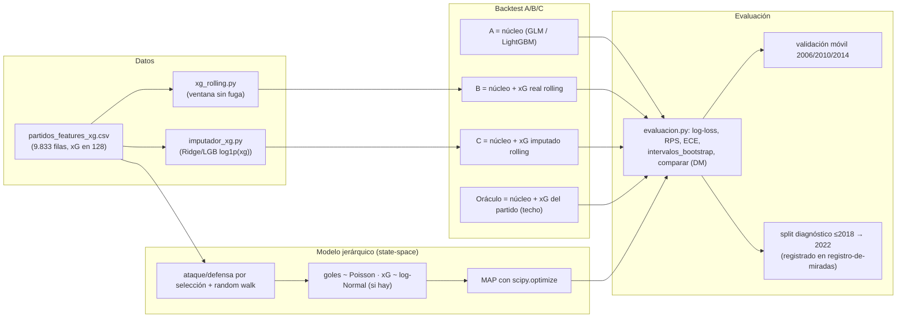

# futbolInferencia — Plan técnico: backtest A/B/C de xG y modelo jerárquico/state-space

**Documento:** 07 · Arquitectura, dataset y tareas (E.2 → D, sin tocar F.3)
**Rol emisor:** Analista de Solución (Arquitecto de Software Senior)
**Entradas autoritativas (verificadas, no se re-auditan):**
- `docs/especificacion/06-xg-moderno.md` — diagnóstico xG (log-loss 1,0636 vs Elo 1,0201 vs GLM 1,0117) y dataset `partidos_features_xg.csv`.
- `docs/especificacion/04-resultados-c-f.md` — etapa F cerrada: **la prueba 2018/2022/2026 ya se miró en F.3 y queda congelada**.
- `docs/especificacion/02-plan-tecnico.md` — contrato `Predictor`, decisión D-08 (xG como `extra`, no 15.ª métrica), vara de medir y reglas de no-fuga.
- Código verificado: `web/fases/predictores.py`, `evaluacion.py`, `dataset.py`, `modelos_estadisticos.py`, `modelos_arboles.py`, `ensamble.py`.

**Destinatarios:** Programador Experto (ejecución) y QA (verificación).
**Fecha:** 2026-11-01 · **Workspace:** `C:\Users\USUARIO\Trabajo\proyectos\mundiales\futbolInferencia`

> **Regla de lectura.** Este plan **no implementa código** y **no re-audita** lo ya verificado. Sólo produce el plan accionable. Toda la experimentación nueva usa **validación**; la prueba 2018/2022/2026 sigue congelada. El backtest xG usa una **partición interna temporal dentro de 2018/2022** (entrenar/imputar en ≤2018, evaluar en 2022) con carácter **diagnóstico**: sus números se registran como una mirada, **no** re-optimizan el modelo final ni se presentan como evidencia nueva de promoción.

---

## 0. Resumen ejecutivo

1. **Backtest A/B/C** (diagnóstico): medir, **sin fuga**, si el xG *histórico* (rolling) recupera la señal que el xG *del partido* no aporta como λ directa. Tres pronosticadores con el **mismo** núcleo (Poisson GLM y LightGBM Poisson):
   - **A** = núcleo sin xG (referencia);
   - **B** = núcleo + xG real rolling (con indicador de cobertura);
   - **C** = núcleo + xG rolling **imputado** donde no hay real.
   Más un **oráculo** (xG del partido como feature) como **techo no desplegable**.
2. **Prototipo jerárquico/state-space** (modelo final candidato): goles (toda la historia) y xG (2018/2022) como observaciones de una **calidad latente** por selección, con *partial pooling* y *random walk* temporal. Se implementa **sin PyMC**: máxima *a posteriori* (MAP) con `scipy.optimize` (patrón ya existente en `PredictorDixonColes`), con `statsmodels`/PyMC-wheel como opciones alternativas.
3. **Honestidad de muestra (obligatoria):** sólo hay **128 partidos con xG**. Toda conclusión A/B/C lleva intervalo bootstrap y Diebold-Mariano, y se lee como *señal direccional*, nunca como efecto grande y significativo. El despliegue final **no** puede usar el xG del partido objetivo.

---

## 1. Arquitectura

### 1.1 Piezas existentes y cómo encajan (verificadas en código)

| Pieza | Uso en este plan |
|---|---|
| `web/fases/predictores.py` | Contrato `Predictor` (`predecir(lote) -> (n,2)`, `probabilidades` opcional, `a_esquema`, `desde_esquema`), `Lote`, `REGISTRO`, `guardar_predictor`, `cargar_predictor`. Todo modelo nuevo se registra aquí; nadie carga un modelo fuera de `cargar_predictor`. |
| `web/fases/evaluacion.py` | `particion(ds, hasta, validacion, prueba)`, `evaluar(..., por_partido=True)`, `metricas`, `intervalos_bootstrap`, `comparar` (bootstrap pareado + Diebold-Mariano + McNemar). Es la vara de medir; **no se reimplementa**. |
| `web/fases/modelos_estadisticos.py` | `PredictorPoissonGLM`, `PredictorDixonColes` (ya usa `scipy.optimize.minimize` con gradiente analítico — patrón a copiar en JH), `_base_lado`, `_matriz_glm`, `_categorias`, `_columna`. El núcleo A/B/C se construye sobre `_matriz_glm`. |
| `web/fases/modelos_arboles.py` | `PredictorLightGBMPoisson` (objetivo `poisson`, una fila por equipo-partido). Segundo núcleo del backtest. |
| `web/fases/dataset.py` | `construir_dataset`/`construir_secuencias`; fuente de verdad de columnas. El xG **no** es una métrica de `ALL_METRICS`: vive en `partidos_features_xg.csv` como columnas `xg_0/xg_1`, `tiros_0/1`, `sot_0/1`, `xG_disponible`. |
| `docs/especificacion/registro-de-miradas.md` | Todo número sobre 2018/2022 (incluido este backtest) se **registra aquí** antes de mirar. |
| `experimentos/*.json` | Salida persistida de cada evaluación. |

**Columna clave:** el CSV xG `data/datasets/partidos_features_xg.csv` tiene 63 columnas (mismas que `partidos_features.csv` + `xg_0,xg_1,tiros_0,tiros_1,sot_0,sot_1,xG_disponible`). **No tiene `fecha`**: el orden cronológico se reconstruye con `(agno, orden)` (ver §2.1). El xG real sólo existe en 64 partidos de 2018 y 64 de 2022, todos `fase == "mundial"`; el resto tiene `xG_disponible=0`.

### 1.2 Archivos nuevos

| Archivo | Responsabilidad | Justificación |
|---|---|---|
| `web/fases/xg_rolling.py` | Construir features rolling de xG sin fuga y el flag de cobertura (`xg_roll_*`). | Lógica de ventana aislada y testeable; reutilizada por A/B/C y por el jerárquico (si lo necesita). |
| `web/fases/imputador_xg.py` | Imputador de xG histórico (Ridge/LightGBM sobre `log1p(xg)`), con CV interna y persistencia. | Separar el "modelo de imputación" (diagnóstico) del "modelo de pronóstico" (final). |
| `web/fases/modelos_jerarquicos.py` | `PredictorJerarquico` (MAP por `scipy`), con `PREDICTORES` dict para `REGISTRO`. | Mismo patrón que `modelos_estadisticos.py`/`modelos_arboles.py`. |
| `web/fases/management/commands/evaluar_xg_backtest.py` | Ejecuta A/B/C + oráculo y vuelca `experimentos/resultados_xg_backtest.json`. | Comando nuevo: **no toca** `evaluar_modelos.py` ni la prueba. |
| `web/fases/management/commands/evaluar_jerarquico.py` | Validación móvil del jerárquico + split diagnóstico xG; vuelca `experimentos/resultados_jerarquico.json`. | Igual: aislado del comando de prueba. |
| `web/fases/tests.py` (ampliar) | Tests de no-fuga del rolling, contrato roundtrip, *shrinkage* del pooling. | QA automática. |

### 1.3 Contrato del modelo nuevo (JH)

`PredictorJerarquico` cumple exactamente el contrato de `predictores.py` (idéntico a `PredictorDixonColes`):

1. `nombre = "jerarquico"`, registrado en `REGISTRO` (vía `PREDICTORES = {...}` al final del módulo).
2. `entrenar(cls, dataset, ...) -> instancia` — ajusta estados latentes + hiperparámetros por MAP.
3. `predecir(self, lote) -> (n,2)` — λ desde los **estados almacenados por equipo** (mapa `home_id/away_id → ataque/defensa`), sin leer ninguna columna nueva en runtime (equipo desconocido → media del pool, 0).
4. `probabilidades(self, lote) -> (n,3)` — **opcional**: se deja que la evaluación derive las dos Poisson independientes (igual que el GLM). No se inventa una distribución de resultado si no aporta.
5. `a_esquema(self)` / `desde_esquema(cls, esquema, carpeta)` — estado serializable (numpy `tolist()`), sin pickles.
6. `guardar_predictor(...)`/`cargar_predictor(...)` para persistir.
7. Columnas requeridas en `a_esquema`: `home_id, away_id, local_0, local_1` (más `xg_0/xg_1/xG_disponible` **sólo durante el entrenamiento**; `predecir` no las necesita). Ningún uso de `descanso`/`grupo` sin la decisión D-04.

### 1.4 Diagrama de flujo



---

## 2. Dataset y features (rolling xG sin fuga + imputación)

### 2.1 Orden cronológico

- El xG sólo existe en `fase == "mundial"` de 2018 y 2022. Dentro de un torneo, `orden` (0..63) es el orden del fixture; entre torneos, `agno` ordena. Por tanto el orden global de los partidos **con xG** es `sort by (agno, orden)`.
- **Matiz honesto:** en fase de grupos algunos partidos son simultáneos y `orden` es un proxy de orden real. Aceptable para un diagnóstico; se documenta como limitación (§7).
- Para la imputación (que corre sobre **toda** la historia, incluidos partidos sin xG) no hace falta orden fino: el imputador usa sólo features **pre-partido** ya computadas (`ALL_METRICS_0/1` + contexto), que no dependen del orden.

### 2.2 Definición exacta del rolling (sin fuga)

Para cada partido `p` y lado `i ∈ {0,1}` (equipo `e = home_id` si `i=0`, `away_id` si `i=1`), usando **estrictamente los partidos anteriores** a `p` (en B: sólo `xG_disponible=1`; en C: real + imputado):

- `xg_roll_for_i`  = media de xG **anotado** por `e` en sus partidos previos (para el equipo: `xg_0` si fue home, `xg_1` si fue away).
- `xg_roll_against_i` = media de xG **recibido** (el xG del rival) en esos mismos partidos previos.
- `xg_roll_n_i`    = número de partidos previos que aportan xG (cobertura).
- `xg_roll_has_i`  = 1 si `xg_roll_n_i > 0`, si no 0 (indicador de missing).

**Ventana:**
- **Primaria:** *expanding* (todos los partidos previos). Con 128 partidos, una ventana fija pequeña deja casi todo en missing.
- **Sensibilidad:** últimos `W ∈ {3, 5}` partidos previos (coherente con `k=5` de `construir_secuencias`). Se reporta aparte; no es la métrica principal.

**Missing (n=0):** `xg_roll_for_i = xg_roll_against_i = media global` (media de xG por lado calculada **sólo en entrenamiento**), y `xg_roll_has_i = 0` le dice al modelo que es missing. Así el GLM/LightGBM puede "aprender a ignorar" el valor de relleno vía el indicador.

**Regla de no-fuga (tests obligatorios):** el rolling del partido `p` **nunca** incluye el xG del propio `p` (comparación estricta `orden_previo < orden_p`), y en el split diagnóstico los features de 2022 se construyen con un imputador calibrado **sólo en ≤2018** (nunca con 2022).

### 2.3 Imputador (para C y como insumo opcional del jerárquico)

- **Target:** `xg` por *equipo-partido* (128 partidos × 2 lados = 256 observaciones reales).
- **Features:** exactamente las de `_base_lado`/`_matriz_glm` (sin intercepto): `elo_diff`, `es_local`, `neutral`, `rate_GF`, `rate_GC_rival`, `gkps`, `mos`, `fase_final`, one-hot de `categoria`. **No** se usan `tiros_*`/`sot_*` (sólo existen donde hay xG y serían fuga para el objetivo de imputación).
- **Modelo:** empezar con `Ridge` de `scikit-learn` sobre `log1p(xg)` (estable en 256 obs, interpretable). Sensibilidad: `LGBMRegressor(objective="poisson")` sobre `xg`. Ambos son diagnóstico, no producción.
- **Validación del imputador:** CV interna (5-fold, semilla fija) **dentro de 2018** (128 obs); reportar `MAE`, `RMSE`, `R²` en escala `log1p` y en escala original. Umbral de "imputador útil": `R²_log1p` claramente > 0 (se documenta el valor; no se fija un corte arbitrario por anticipado).
- **Aplicación:** imputar xG en todas las filas históricas (pre-2018 y no-mundial); **conservar** el xG real donde existe. En el split ≤2018→2022, el imputador que alimenta las features de 2022 se calibra **sólo** en 2018.
- **Domain shift honesto:** el imputador se entrena en partidos de mundial y se aplica a eliminatorias/amistosos. Se reporta explícitamente como limitación.

### 2.4 Feature final para el núcleo

El núcleo (GLM y LightGBM Poisson) recibe las features existentes de `_matriz_glm` **más**, por lado `i`, `xg_roll_for_i`, `xg_roll_against_i`, `xg_roll_n_i`, `xg_roll_has_i`. A añade nada; B añade el rolling real; C añade el rolling imputado. Misma matriz y misma salida `(n,2)` en los tres: la única diferencia es el conjunto de columnas.

---

## 3. Backtest A/B/C

### 3.1 Pronosticadores

| ID | Definición | Qué responde |
|---|---|---|
| **A** | Núcleo sin xG (GLM y LightGBM Poisson, configuración ya conocida de B/C). | Referencia. |
| **B** | Núcleo + rolling de xG **real** (con `xg_roll_n_i` y `xg_roll_has_i`). | ¿El xG histórico *real* (escaso) aporta? |
| **C** | Núcleo + rolling de xG **imputado** donde no hay real (real donde sí lo hay). | ¿Imputar el hueco recupera más señal que sólo lo real? |
| **Oráculo** | Núcleo + **xG del partido objetivo** como feature (y `λ = xg` directo, ya medido: 1,0636). | Techo: si ni siquiera esto gana, el xG no aporta nada como feature tabular. **No desplegable.** |

### 3.2 Partición temporal (interna, diagnóstica)

- **Entrenamiento del núcleo:** `particion(ds_xg, 2018, prueba=None)[0]` → `agno <= 2018` (toda la historia hasta 2018 inclusive). Para LightGBM, parada temprana sobre un *slice* de validación **interno** al entrenamiento (último ciclo ≤2018); **nunca** sobre 2022.
- **Calibración del imputador (sólo C y oráculo-C):** los 64 partidos reales de 2018.
- **Evaluación (diagnóstico):** `particion(ds_xg, 2018, prueba=[2022])[2]` → los 64 partidos de mundial de 2022.
- **2018 como objetivo:** **no** aporta (no hay xG previo a 2018, y calibrar el imputador con el propio 2018 sería fuga). Se reporta `A` en 2018 sólo como sanity; `B` y `C` **colapsan a A** allí y así se documenta.
- **Registro:** antes de ejecutar, se añade una entrada en `docs/especificacion/registro-de-miradas.md` ("backtest xG diagnóstico, split ≤2018→2022"); los números resultantes **no** se usan para re-optimizar el modelo final ni como nueva evidencia de promoción.

### 3.3 Métricas y comparación

- **Primaria:** `log_loss`. **Secundarias:** `rps`, `ece`, `acierto_resultado`, `marcador_exacto`.
- **Incertidumbre:** `intervalos_bootstrap` (95 %, `REMUESTREOS=2000`) sobre los 64 partidos; `comparar` para los pares **A–B**, **A–C**, **B–C** en `log_loss` y `rps` (ya devuelve `diferencia`, `intervalo`, `p_bootstrap`, `dm`, `p_dm`, `p_mcnemar`).
- **Lectura con n=64:** el Diebold-Mariano tiene poca potencia en 64 partidos; se reporta dirección + IC + `p`, y se **prohíbe** interpretar `p≥0,05` como "no aporta" ni `p<0,05` como "aporta fuerte". El veredicto es direccional.

### 3.4 Oráculo (techo, no desplegable)

1. **O1 — xG como λ:** `λ_0=xg_0, λ_1=xg_1` (ya medido en 06: log-loss 1,0636, **peor** que Elo/GLM). Contexto de techo.
2. **O2 — núcleo + xG del partido como feature:** el "imputador perfecto". Si `O2 ≈ A`, el xG no aporta señal tabular y **se cierra la línea tabular** (todo el esfuerzo pasa a JH). Si `O2 ≻ A` pero `B/C ≈ A`, la señal existe pero **no se puede recuperar sin el partido** (fuga) → confirma que el camino correcto es el jerárquico. Ambos marcados **no desplegables** en esquema y en informe.

### 3.5 Qué conclusión permite

- `B ≻ A` (dirección consistente + IC estrecho) ⇒ el xG real rolling aporta.
- `C ≻ B` ⇒ la imputación recupera señal más allá de lo real escaso.
- `C ≻ A` con `B ≭ A` ⇒ la imputación es la que desbloquea la señal.
- Ninguna ⇒ el xG no funciona como feature rolling tabular; el valor (si lo hay) está en el modelo jerárquico, que es su lugar natural.
- En todos los casos: **n=64**, conclusión direccional, y el despliegue nunca usa el xG del partido.

---

## 4. Prototipo jerárquico/state-space

### 4.1 Variables latentes y verosimilitudes

- **Latentes:** por selección `i` y ciclo `t` (ciclo = año de mundial, `agno`): ataque `α_{i,t}` y defensa `δ_{i,t}`. Es la "calidad latente" que los goles y el xG miden de forma ruidosa.
- **Goles (toda la historia):** para un partido en el ciclo `t`:
  ```
  log λ_home = β0 + α_{h,t} − δ_{a,t} + γ·local_0
  log λ_away = β0 + α_{a,t} − δ_{h,t} + γ·local_1
  goles_0 ~ Poisson(λ_home),  goles_1 ~ Poisson(λ_away)
  ```
  (`β0` intercepto, `γ` ventaja de local.)
- **xG (sólo 2018/2022):** observación adicional de la **misma** media latente, con un sesgo sistemático `η`:
  ```
  log xg ~ Normal(log λ + η, σ_xg)     # xG log-normal centrado en λ·exp(η)
  ```
  (Alternativa equivalente si el log-normal se queda corto: `xg ~ Gamma(media = λ·exp(η), dispersión φ)`. Empezar con log-normal.)

### 4.2 Priors jerárquicos y random walk

- **Partial pooling (nivel 1):** `α_{i,t} ~ Normal(0, σ_att)`, `δ_{i,t} ~ Normal(0, σ_def)`. Los equipos con poca historia se **encogen** hacia la media del pool; los de mucha historia conservan su estimación. Identificabilidad: centrar (`Σ α = 0`, `Σ δ = 0`) o fijar `μ_att=μ_def=0`.
- **Evolución temporal (nivel 2, random walk):**
  ```
  α_{i,t} = α_{i,t-1} + ε^α,  ε^α ~ Normal(0, σ_rw_att)
  δ_{i,t} = δ_{i,t-1} + ε^δ,  ε^δ ~ Normal(0, σ_rw_def)
  ```
  entre ciclos consecutivos en que `i` aparece. Es un suavizado state-space estándar (filtro/suavizador de Kalman en forma penalizada).
- **Hiperparámetros:** `σ_att`, `σ_def`, `σ_rw_att`, `σ_rw_def`, `σ_xg`. **Empezar fijos** (`σ_att=σ_def=0.5`, `σ_rw=0.3`, `σ_xg=0.4`) y luego barrerlos en validación móvil (no en prueba).

### 4.3 Ausencia de xG (clave)

- Donde `xG_disponible=0` (toda la historia pre-2018 y todos los no-mundiales), **se omite el término xG** de la log-verosimilitud; sólo contribuyen los goles. No hay imputación forzada: la verosimilitud es *parcial* por construcción.
- Donde `xG_disponible=1` (2018/2022 mundial), contribuyen **ambas** verosimilitudes. El peso relativo lo fija `σ_xg` (cuanto menor, más se cree al xG).

### 4.4 Entrenamiento y predicción (sin usar el xG del partido objetivo)

- **Entrenamiento (MAP):** minimizar con `scipy.optimize.minimize(method="L-BFGS-B")` la **negativa de la log-posterior** = −[log-verosimilitud de goles + log-verosimilitud de xG (donde haya) + log-priors + penalizaciones random-walk]. Gradiente analítico opcional (espejo de `PredictorDixonColes`); es un problema convexo por bloques, L-BFGS-B lo resuelve en segundos para cientos de equipos × ~21 ciclos.
- **Predicción:** el estado que se usa es el **último estado filtrado** disponible en el corte de entrenamiento (por equipo). Para un ciclo futuro se **extrapola** con la media del random walk = el último estado (sin deriva). El xG del partido objetivo **jamás** entra en `predecir`.
- **En runtime (deployment):** `predecir(lote)` mapea `home_id/away_id → estados finales almacenados` (igual que `PredictorDixonColes` guarda `ataque/defensa` por equipo). Equipo desconocido → media del pool (0). **No** se necesitan columnas nuevas en el `Lote`, por lo que es desplegable sin tocar `contexto_simulacion`.

### 4.5 Implementación sin PyMC (opciones, por orden pragmático)

1. **(RECOMENDADO) MAP con `scipy.optimize` — `web/fases/modelos_jerarquicos.py`.** Cero dependencias nuevas; reutiliza el patrón de gradiente analítico y centrado de `PredictorDixonColes`. Demuestra *partial pooling* + *random walk* + verosimilitud xG en una pasada. Es el primer entregable.
2. **`statsmodels` — NO es la herramienta exacta.** `statsmodels` no tiene una clase para "Poisson jerárquico + random walk temporal + segunda verosimilitud Normal xG". Lo más cercano es `statsmodels.genmod.bayes_mixed_glm.BayesMixedGLM` (GLMM variacional con interceptos aleatorios = *partial pooling*), pero **sin** random walk ni verosimilitud xG. Útil sólo como hito intermedio "¿el pooling ayuda?" (interceptos aleatorios), no como modelo objetivo. No forzar `MixedLM` (es Gaussiano, no cuenta).
3. **PyMC por wheel directo (opcional, JH-05).** El índice pip está bloqueado, pero se puede bajar el wheel de PyMC + dependencias (`pytensor`, etc.) e instalarlo con `pip install <wheel>` sin índice. Riesgo: PyMC en Windows + Python 3.12 + numpy 2.5 puede no tener wheel compatible; sólo se intenta **si** la versión MAP (JH-03) muestra señal y se quiere el posterior completo (intervalos de credibilidad sobre estados y λ). No bloquea el plan.

### 4.6 Evaluación (sin tocar la prueba)

1. **Validación móvil existente** (pliegues 2006/2010/2014, mismos que `evaluar_modelos`): aquí **no hay xG** (empieza en 2018), así que el jerárquico degenera a un "Poisson jerárquico de goles". Sirve para responder si el *partial pooling* + *random walk* baten a Elo/GLM **en la métrica desplegable real** (que no tiene xG). Métricas: `evaluar(..., por_partido=True)` + `comparar` vs Elo y vs `PredictorPoissonGLM`.
2. **Split diagnóstico xG** (≤2018 → 2022, registrado como mirada): entrena el jerárquico hasta 2018 **incluyendo el xG de 2018** y predice 2022 con el estado de 2018. Compara `jerárquico+xG` vs `jerárquico sin xG` vs Elo/GLM. Esto mide si el xG como **observación de calidad latente** (no como feature) aporta.
3. **Demostración de partial pooling (criterio de aceptación):** el *shrinkage* de equipos con pocos partidos debe acercar su `α/δ` a la media del pool más que a la estimación sin pooling; se compara contra `PredictorDixonColes` (efectos fijos, sin pooling). Se cuantifica (p. ej. ratio de shrinkage < 1 para equipos de N bajo).

---

## 5. Tareas

> Convenciones: esfuerzo en días-persona (d). Cada tarea es un PR pequeño. Dependencias como IDs. "Aceptación" = criterios verificables por QA.

### Bloque XG — Backtest A/B/C (diagnóstico del imputador)

#### XG-01 · `xg_rolling.py` — features rolling sin fuga
- **Objetivo:** construir las columnas rolling de xG (`xg_roll_for_i`, `xg_roll_against_i`, `xg_roll_n_i`, `xg_roll_has_i`) con ventana *expanding* y opción `W∈{3,5}`, respetando el orden `(agno, orden)` y la exclusión estricta del partido actual.
- **Archivos:** `web/fases/xg_rolling.py` (nuevo), `web/fases/tests.py`.
- **Pasos:** (1) leer `data/datasets/partidos_features_xg.csv`; (2) armar historia por equipo (anotado/recibido) en orden `(agno, orden)`; (3) calcular medias previas + conteo + indicador; (4) relleno de missing con media global de entrenamiento + `xg_roll_has_i`; (5) tests.
- **Aceptación:** test de no-fuga: para un partido `p`, las features no cambian si se altera el xG del propio `p`; `xg_roll_n_i == 0` en el primer partido con xG de cada equipo; ventana `W` usa exactamente los últimos W previos; el CSV no se modifica.
- **Dependencias:** —. **Esfuerzo:** 1–1,5 d.

#### XG-02 · `imputador_xg.py` — imputador con CV interna
- **Objetivo:** entrenar y validar el imputador de xG histórico (Ridge sobre `log1p(xg)`; sensibilidad LightGBM), con CV de 5 pliegues dentro de 2018.
- **Archivos:** `web/fases/imputador_xg.py` (nuevo), `web/fases/tests.py`.
- **Pasos:** (1) features de `_base_lado`/`_matriz_glm` (sin intercepto) para las 256 observaciones reales; (2) Ridge (`alpha` por CV) sobre `log1p(xg)`; (3) reportar `MAE/RMSE/R²` en `log1p` y original; (4) aplicar a la historia y devolver `imputed_xg` (conservando real); (5) test de que el imputador calibrado en 2018 **no** usa ninguna fila de 2022.
- **Aceptación:** `R²_log1p` reportado; test de no-fuga temporal (entrenar en 2018 ⇒ `predict` sobre 2022 no toca 2022); imputación reproducible con semilla fija.
- **Dependencias:** XG-01. **Esfuerzo:** 1 d.

#### XG-03 · `evaluar_xg_backtest.py` — A/B/C + oráculo
- **Objetivo:** ejecutar A/B/C (GLM y LightGBM Poisson) y el oráculo O2, en el split ≤2018→2022, con métricas, bootstrap y Diebold-Mariano.
- **Archivos:** `web/fases/management/commands/evaluar_xg_backtest.py` (nuevo), `experimentos/resultados_xg_backtest.json` (nuevo).
- **Pasos:** (1) `entr, _, test = particion(ds_xg, 2018, prueba=[2022])`; (2) entrenar A/B/C reutilizando `PredictorPoissonGLM.entrenar`/`PredictorLightGBMPoisson.entrenar` con las features de §2.4; (3) O2 = núcleo + columnas `xg_0/xg_1` del partido (sólo diagnóstico); (4) `evaluar(..., por_partido=True)` + `intervalos_bootstrap` + `comparar` (A–B, A–C, B–C, A–O2); (5) volcar JSON.
- **Aceptación:** JSON con tabla A/B/C/O2 (log_loss, rps, ece, acierto) + IC 95 % + `comparar` por pares; comando corre sin tocar `evaluar_modelos.py` ni escribir en la prueba; se imprime la advertencia `n=64`.
- **Dependencias:** XG-01, XG-02. **Esfuerzo:** 1–1,5 d + ejecución.

#### XG-04 · Gate XG — interpretar, registrar mirada y decidir
- **Objetivo:** leer el resultado direccional, registrarlo como mirada y emitir la decisión go/no-go para JH.
- **Archivos:** `docs/especificacion/registro-de-miradas.md` (añadir entrada), `experimentos/resultados_xg_backtest.json` (fijar).
- **Pasos:** (1) registrar la mirada **antes** de ejecutar; (2) escribir la conclusión (§3.5) con el veredicto direccional y las limitaciones de muestra; (3) si O2≈A, marcar "línea tabular cerrada"; si hay señal, priorizar JH-03.
- **Aceptación:** entrada en el registro con fecha/motivo; conclusión explícita y sin sobre-afirmación; no se promueve ningún modelo ni se re-mira 2026.
- **Dependencias:** XG-03. **Esfuerzo:** 0,5 d.

### Bloque JH — Modelo jerárquico/state-space

#### JH-01 · `PredictorJerarquico` estático (partial pooling, sólo goles)
- **Objetivo:** versión más simple que demuestre *partial pooling*: `α_i`, `δ_i` por selección (sin tiempo), goles ~ Poisson, priors Gaussianas, MAP con `scipy`.
- **Nota de signo (cerrada):** la implementación usa `λ = exp(β0 + α_atacante + δ_defensor + γ·local)`, con `δ` positivo = concede más goles (debilidad). Es equivalente al `-δ` del §4.1 bajo priors simétricos; `δ_plan = -δ_impl`.
- **Archivos:** `web/fases/modelos_jerarquicos.py` (nuevo), `web/fases/predictores.py` (registrar vía `PREDICTORES`), `web/fases/tests.py`.
- **Pasos:** (1) clase `PredictorJerarquico` con `nombre="jerarquico"`, `entrenar` (L-BFGS-B sobre `α,δ,β0,γ` + priors), `predecir` (estados por `home_id/away_id`), `a_esquema`/`desde_esquema`; (2) registrar; (3) tests de contrato (roundtrip, `(n,2)`) y test de *shrinkage* (equipo con 1 partido ⇒ `α` cercano a 0; equipo con muchos ⇒ más extremo).
- **Aceptación:** `cargar_predictor` reconstruye; `evaluar` finito en validación; test de shrinkage verde; sin dependencias nuevas.
- **Dependencias:** —. **Esfuerzo:** 1,5–2 d.

#### JH-02 · Random walk temporal (state-space)
- **Objetivo:** añadir `α_{i,t}`, `δ_{i,t}` por (selección, ciclo) con penalización random walk `σ_rw`.
- **Archivos:** `web/fases/modelos_jerarquicos.py`, `web/fases/tests.py`.
- **Pasos:** (1) índice `t = agno` (ciclo); (2) penalización `(α_{i,t} − α_{i,t-1})²/(2σ_rw²)` entre ciclos consecutivos; (3) predecir con el **último** estado filtrado (extrapolación sin deriva); (4) test de que el estado en `t` no usa datos de `t+1`.
- **Aceptación:** roundtrip; suavizado visible (estados de un equipo varían menos entre ciclos consecutivos que las medias crudas); `σ_rw=0` recupera el modelo estático (test de equivalencia).
- **Dependencias:** JH-01. **Esfuerzo:** 1–1,5 d.

#### JH-03 · Verosimilitud xG (log-Normal) con omisión
- **Objetivo:** incorporar `log xg ~ Normal(log λ + η, σ_xg)` sólo donde `xG_disponible=1`.
- **Archivos:** `web/fases/modelos_jerarquicos.py`, `web/fases/tests.py`.
- **Pasos:** (1) término xG en la log-verosimilitud condicionado a `xG_disponible`; (2) parámetros `η`, `σ_xg`; (3) entrenar leyendo `partidos_features_xg.csv`; (4) test: en pliegues sin xG (2006/2010/2014) el resultado **coincide** con JH-02 (el término se omite); `predecir` no lee `xg_*`.
- **Aceptación:** el término xG no cambia el entrenamiento cuando `xG_disponible=0`; `predecir` no usa el xG del objetivo; roundtrip.
- **Dependencias:** JH-02. **Esfuerzo:** 1 d.

#### JH-04 · Evaluación: validación móvil + split diagnóstico xG
- **Objetivo:** medir el jerárquico vs Elo y GLM en los pliegues 2006/2010/2014, y en el split ≤2018→2022 (jerárquico+xG vs jerárquico vs Elo/GLM).
- **Archivos:** `web/fases/management/commands/evaluar_jerarquico.py` (nuevo), `experimentos/resultados_jerarquico.json` (nuevo), `docs/especificacion/registro-de-miradas.md`.
- **Pasos:** (1) pliegues móviles con `evaluar(..., por_partido=True)` + `comparar` vs Elo y GLM; (2) split diagnóstico ≤2018→2022 con y sin xG (registrar mirada); (3) volcar JSON con IC y `p_dm`.
- **Aceptación:** tabla de validación móvil (log_loss, rps, ece, acierto + IC) con `contra_elo`/`contra_glm`; split xG registrado y sin tocar 2026; conclusión explícita de si el pooling/random walk/xG baten a Elo/GLM.
- **Dependencias:** JH-03. **Esfuerzo:** 1 d + ejecución.

#### JH-05 · (⚙ opcional) PyMC por wheel directo — posterior completo
- **Objetivo:** si JH-03/JH-04 muestran señal, obtener posterior bayesiano completo (intervalos de credibilidad) con PyMC instalado por wheel.
- **Archivos:** wheel descargado + `web/fases/modelos_jerarquicos.py` (variante), nota en `requirements-dev.txt`.
- **Pasos:** (1) bajar wheels de PyMC + dependencias (pytensor, etc.) sin índice; (2) instalarlos en `.venv`; (3) reespecificar el modelo (mismo §4) con NUTS; (4) comparar MAP vs posterior (medias e IC).
- **Aceptación:** posterior muestreado; IC de credibilidad sobre λ; documentado el coste/beneficio vs MAP.
- **Dependencias:** JH-03. **Esfuerzo:** 2–3 d. **Riesgo:** wheels incompatibles con Windows/Py3.12/numpy 2.5; no bloquea.

---

## 6. Matriz de trazabilidad (guía v2)

| Tarea | E.2 (datos xG) | D (red/fondo) | F (elección/prueba) | Decisiones/restricciones |
|---|---|---|---|---|
| XG-01 | Construye el rolling del xG de E.2 sin fuga | — | — | D-08 (xG como `extra`); A-05 (no-fuga) |
| XG-02 | Imputa el xG histórico de E.2 | — | — | D-08; D-13 (métrica/validación) |
| XG-03 | Mide si el xG aporta (E.2) | — | No toca F.3 | D-13; R-02 (validación); R-01 (congelar prueba) |
| XG-04 | Conclusión de E.2 | — | Registra mirada (F.3 respetado) | R-01 |
| JH-01 | — | Alternativa a D.4/D.5 (state-space) | — | R-07 (contrato `Predictor`) |
| JH-02 | — | D.4/D.5: evolución temporal | — | R-02 |
| JH-03 | xG como observación latente (E.2) | — | — | D-08 |
| JH-04 | E.2 | Compara contra Elo/GLM | Validación móvil + split registrado | R-02; R-01; D-13 |
| JH-05 | — | — | — | opcional |

Referencias de la guía v2: **E.2** = datos modernos/xG (`06-xg-moderno.md`); **D** = "red a fondo" (aquí el jerárquico/state-space es la alternativa que captura forma y evolución, D.4/D.5); **F** = ensamble y elección (F.3 = única mirada ya hecha, queda congelada); **D-08** = xG como contexto/`extra`, no 15.ª métrica; **D-13** = log-loss primaria, α=0,05, IC sin 0; **R-01/R-02** = congelar prueba / validación móvil; **A-05** = auditoría de no-fuga.

---

## 7. Riesgos y limitaciones

| Riesgo | Impacto | Mitigación |
|---|---|---|
| **Muestra xG mínima (128 partidos).** | Toda conclusión es direccional; DM sin potencia en n=64. | IC bootstrap + `p_dm` siempre; veredicto "direccional", nunca "significativo fuerte"; no se sobre-afirma. |
| **`orden` como proxy de cronología** (simultaneidad en grupos). | Orden ligeramente arbitrario dentro del torneo. | Documentar; sensibilidad reordenando partidos simultáneos; no cambia el split 2018→2022. |
| **Domain shift del imputador** (mundial → eliminatorias/amistosos). | Imputación sesgada fuera de mundiales. | Reportar `R²`/`MAE`; tratar C como diagnóstico, no como modelo de producción. |
| **Fuga vía imputador** (calibrarlo con 2022). | Invalida C y contamina el split. | Test temporal obligatorio (XG-02): imputador de 2022 calibrado sólo en ≤2018. |
| **Fuga vía rolling** (incluir el partido objetivo). | Invalida A/B/C. | Test XG-01 (alterar el xG del partido no cambia sus features). |
| **PyMC/wheel incompatible** (Windows + Py3.12 + numpy 2.5). | JH-05 bloqueado. | JH-05 es opcional; el MAP con `scipy` cubre el objetivo. |
| **statsmodels sin la clase exacta.** | Expectativa errónea de "una clase que lo hace". | Se declara desde el plan: `BayesMixedGLM` sólo como hito de pooling; el modelo objetivo es MAP por `scipy`. |
| **Re-mirar la prueba.** | Contamina la decisión final. | Comandos nuevos; `registro-de-miradas.md` actualizado antes de ejecutar; 2026 nunca se toca. |
| **Optimización MAP con miles de parámetros** (equipos × ciclos). | L-BFGS-B lento o mal condicionado. | Centrar + priors; empezar con σ fijos; si hace falta, suavizado de Kalman en bloques (escalado posterior). |

---

## 8. Regla final de despliegue (honestidad)

- **Ningún** artefacto de este plan usa el xG **del partido objetivo** en `predecir`. El oráculo (O1/O2) existe **sólo** como techo y se marca `no_desplegable` en esquema/informe.
- El jerárquico, si gana, se despliega con los **estados latentes almacenados** por equipo (sin columnas nuevas en runtime), exactamente como hoy se despliega `PredictorDixonColes`.
- La decisión de promover cualquier modelo sigue el flujo existente: **validación móvil** (R-02) para elegir, **una sola mirada** pre-registrada a la prueba sólo cuando el dueño lo autorice (F.3 ya consumido; cualquier re-mirada se registra y no se presenta como virgen).
